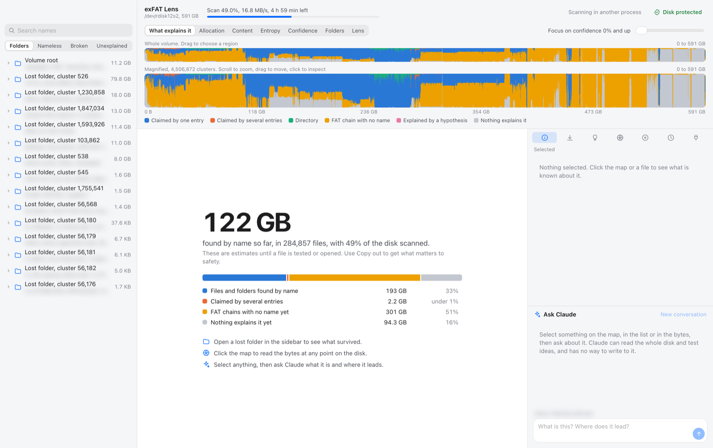
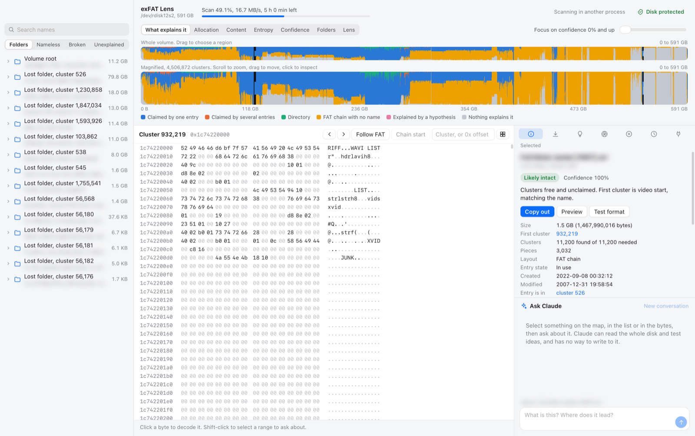
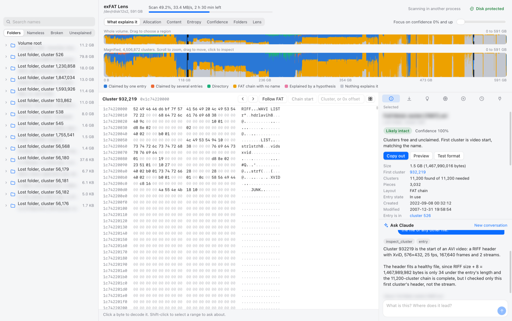
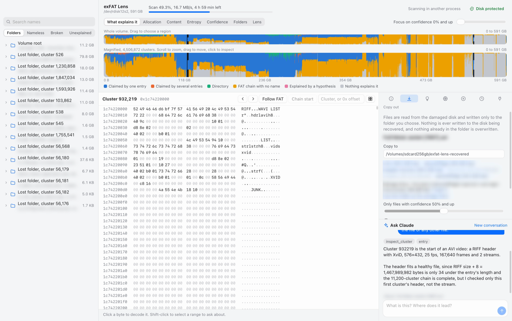
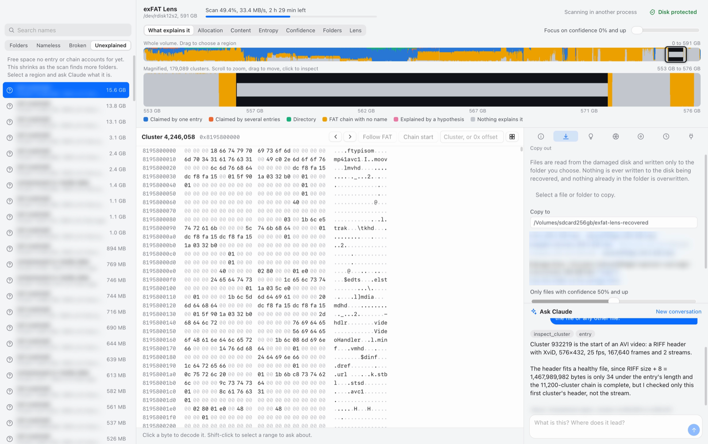
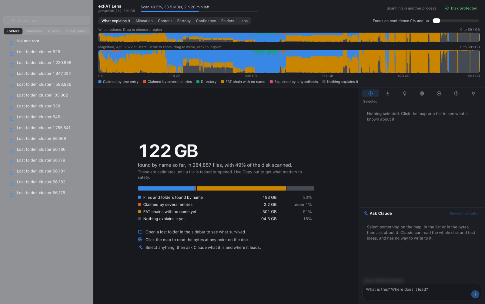
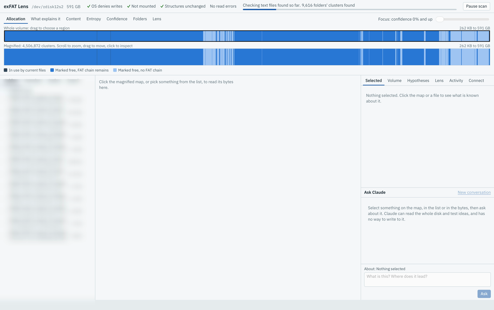
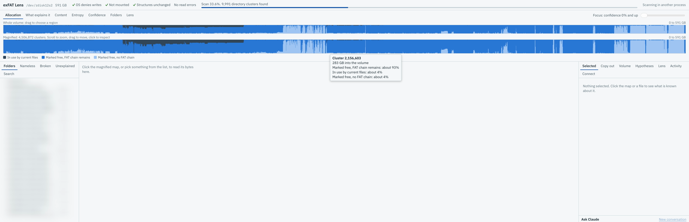

# Captain Salvage

Find the lost treasure on your old, broken drives.

Captain Salvage is a read-only disk recovery tool for macOS. When a repair tool
says a volume is fine but your files are gone, the data is often still there,
with only the links to it cut. This app reads the disk directly, maps what it
finds, and helps you get your files back, without ever writing to the disk.


> **Early development.** Supports exFAT, FAT12, FAT16, FAT32 and NTFS. exFAT has been tested
> on one real damaged volume plus synthetic volumes; FAT-family and NTFS integration are
> tested with synthetic disk images only, so neither has yet recovered a real damaged drive.
> NTFS has limits, listed under [NTFS volumes](#ntfs-volumes). It is not released yet.

The [illustrated user manual](docs/manual/index.html) shows every part of the app: a safe
first recovery, the Simple and Investigate modes, and a guide to each screen. Open it directly
in a browser; it needs no server or build step. Its screenshots use only synthetic disks.

Screenshots of earlier versions are with their releases in the [changelog](#changelog).

## What makes it different

Most tools give a yes or no. A checksum fails, so the file is gone. Captain Salvage
treats damage as something to route around:

- **It weighs damage.** A damaged entry gets a lower confidence score, not a
  rejection. If it points at a real folder, the trail continues.
- **It shows the whole disk.** The map shows what explains every cluster: a named
  file, a folder, a FAT chain with no name, or nothing yet. Zoom from the whole
  volume down to single bytes.
- **It keeps your theories separate from the disk.** A hypothesis, such as "these
  clusters belong to this file", is an overlay you can switch off. The map
  recalculates, and the disk is never touched.
- **It tests its guesses.** It walks PNG chunks, JPEG markers, MP3 frames and zip
  CRCs through a reassembled file, and reports where the file breaks.
- **It looks inside archives.** Open a zip, tar, tar.gz, tar.xz, tar.bz2, tar.zst, gz, xz,
  bz2, zst, 7z or rar to see its files as a tree, read live from the disk. A file whose name was
  lost is recognised by its first bytes. If a zip has lost its directory, the list is rebuilt
  from the headers of the files inside. A damaged tar lists as far as it can be read. Each
  file can be checked: against its own checksum in a zip, 7z or rar, and against the stream's
  checksum for a compressed file.
- **An AI can investigate with you.** Select anything and ask an agent about it, in the
  Chat with an agent tab: Claude Code, Codex or opencode, with the model you choose. The agent works
  through the same tools as the app, over MCP, and has no write path to the disk.

## Safety

This app never writes to the disk being recovered. That is the rule the design starts from.
macOS can, though, and that can happen before the app is open. See
[Before you plug the disk in](#before-you-plug-the-disk-in).

- Devices are only ever opened read-only, and the read interface has no write method.
- The volume stays unmounted during a scan, because macOS writes to a volume when it mounts it.
- The app checks that the boot regions, FAT, bitmap and root directory still match
  the hash first recorded here. That only covers changes after it was recorded.
- The app follows the kernel's write counter for the disk, and warns if it moves while
  the volume is open. The counter covers the whole disk and has no dates, so it is evidence
  and not proof.
- After a scan, the Overview lists each date the volume's `.Spotlight-V100` and `.fseventsd`
  folders changed, as a record of when macOS last wrote there.
- While the app is open, macOS is told not to put disks to sleep. A damaged old disk can
  drop off USB when woken, and each return lets macOS mount it and write to it again. A
  drive's own firmware may still sleep.
- If the disk is disconnected, the app says so, and stops scans, file tests and copies
  instead of treating failed reads as damage. When the volume comes back under a new disk
  number, the app finds it and warns if macOS has mounted it.
- Copy out refuses any destination on the disk being recovered, including through
  an APFS container, and refuses if it cannot tell which disk a destination is on.
- Copy out never overwrites a file. Each copy is hashed as it is read, then hashed
  again from the destination. The copy report shows every file copied, complete or partial,
  and can read every copy again later to catch one changed or lost since. It reads only the
  destination.
- Only the person using the app can start a copy or choose a salvage drive. An AI can
  plan a copy, but not start one.
- While the app is open, macOS cannot mount a volume the person blocked. See
  [Before you plug the disk in](#before-you-plug-the-disk-in).

### Before you plug the disk in

macOS mounts a volume as soon as its disk is attached, and writes to it while it stays
mounted. On one real recovery, a damaged volume stayed mounted for 13 minutes before anyone
unmounted it. In that time macOS changed 36 directory entries, about 0.8 MB, inside
`.Spotlight-V100` and `.fseventsd`, and created files on clusters that had been unclaimed.
Those clusters could have held lost data.

Captain Salvage does not unmount anything itself, because unmounting writes to the disk too.
Set this up before you start:

1. Block mounting. Each volume on the start screen, and on the Overview of the open disk, has
   **Block mounting while Captain Salvage is open**. While the app is open, macOS refuses
   every mount of a blocked volume: when the disk is plugged in, from Finder, from Disk Utility
   and from `diskutil mount`. It needs no administrator rights and changes nothing on the
   system. When the app quits, macOS mounts as usual again, so plug the disk in only with the
   app open. Volumes you have opened before can be blocked before the disk is attached. A new
   one is mounted once when first plugged in: block it, then unmount it once.

   An `/etc/fstab` line with `noauto` is not enough. On one real recovery, macOS mounted the
   volume about 20 seconds after it was attached, with the line in place.
2. Keep disks awake when the app is closed too. While it is open, it does this for you.

   ```
   sudo pmset -a disksleep 0
   ```

3. Do not run First Aid or `fsck` on it, because both of them write.

If the volume is already mounted, the choice is yours. Staying mounted lets macOS keep writing,
and unmounting flushes pending writes, so both change the disk. One real unmount added 23 write
operations and 98 KB. If the disk keeps dropping off, check the cable and power, and avoid hubs.

An agent can block a volume over MCP, because that only protects it. Only the person using
the app can turn a block off.

### Going back to normal

Turn **Block mounting** off for the volume, and set disk sleep back:

```
sudo pmset -a disksleep 10
```

Use the value `disksleep` had before if it was not 10. If you added an `/etc/fstab` line for
the volume with an earlier version, remove it with
`sudo sed -i '' '/^UUID=YOUR-VOLUME-UUID /d' /etc/fstab`.

## Investigating raw disks and overlapping filesystems

Opening raw bytes does not require a recognised filesystem. The normal **Open** action opens
unrecognised sources in the byte-based graph. To inspect bytes beneath a recognised filesystem,
use **Source bytes**, **Inspect raw partition**, **Inspect whole disk**, or **Inspect raw disk or image**. The
source stays read-only, but macOS and other programs may still write to a mounted disk;
the safety precautions above still apply.

Raw sources open in the normal workspace, with the same toolbar, sidebar, overview, and
selection inspector. In **Investigate** mode, the existing disk graph works in byte offsets,
with layers for source bytes, declared MBR/GPT partitions, and filesystem evidence. Nothing
requires a filesystem to be recognised first. Select a partition in the sidebar, drag across
any region of the graph, or enter exact byte offsets in the inspector. **Search for filesystem
evidence** examines that entire range in bounded, pausable batches, including bytes inside
declared partitions. Finding NTFS does not stop the search for older exFAT or FAT structures.
Unreadable ranges are reported separately; unrecognised bytes are never assumed to be empty.

Select evidence or label a region with a suspected format, then **Try this interpretation**.
FAT12/16/32 and exFAT interpretations use the existing scan, browse and recovery workflow,
with reads bounded to that region. The label, extent, and boot-metadata selection are saved
with that interpretation's separate recovery workspace, not in the source's partition table.
The **Source bytes** tab returns from an interpreted filesystem to the whole source and its
discovery findings, without opening a different interface.

Each completed discovery batch saves its findings and checkpoint atomically in
`~/Library/Application Support/Captain Salvage/raw-scans.sqlite`, never on the examined source.
The toolbar shows scan speed and an estimated time remaining after the first batch. Estimates
use the current running period, excluding time spent paused, and may change around slow or
unreadable regions. An interrupted batch is repeated from the last committed checkpoint.

A permanent scan ID identifies the saved analysis; a separate versioned fingerprint records
capacity and SHA-256 hashes of up to sixteen 4 KiB samples spread across the source. Reopen the
disk or a matching raw image, then choose **Load saved scan** and **Resume scan**. Device numbers,
paths and hardware serials are not used as proof of matching contents. Multiple scan IDs can
analyse different ranges of the same contents. Loading explicitly accepts that matching
samples do not prove every byte is identical; mismatching, unreadable or incompatible
fingerprints block resume. A scanner-version mismatch also requires a new scan. Previous read
failures are retained as source-specific evidence, not attributed to a clone: loading rewinds
to retry those regions, and successful rereads clear the outstanding failures. Sources with
unreadable fingerprint samples can still be scanned and saved, but cannot be verified for
resume after reopening. Scans made by older versions without these checkpoints cannot be
recovered after that older app closes.

The CLI uses the same saved scans:

```sh
captainsalvage disk /path/to/disk.img --scan
captainsalvage disk /path/to/clone.img --list-scans
captainsalvage disk /path/to/clone.img --resume SCAN_ID --accept-sampled-match
```

New scans may specify `--offset BYTES --length BYTES`; resumed scans always use their saved range.

A surviving exFAT backup boot region can supply an in-memory interpretation when the main
boot region has been overwritten, for example by NTFS. The same holds for NTFS: the copy of
its boot sector in the volume's last sector, one sector past the end of the volume, can stand
in for a main boot sector that was written over. Pass that sector's offset as the boot
evidence. The original bytes remain available in the raw view and are not repaired or
replaced on disk. This requires enough surviving metadata and valid geometry: isolated
directory entries are evidence, not proof of a complete volume or enough information to
locate every file. Candidate extents may overlap; these are hypotheses, not claims that the
disk's current partition layout is wrong.

The initial probes recognise FAT boot geometry, exFAT boot regions and checksummed directory
entry sets, NTFS boot sectors and their backups, and BitLocker boot sectors, which are
reported as encrypted and not readable. The ext4, Btrfs, and bcachefs probes are not
implemented yet. Extended MBR chains and backup-GPT recovery are also not
implemented; unsupported or invalid tables produce warnings without preventing raw access.

## NTFS volumes

NTFS opens in the same workspace as exFAT and FAT, with the same read-only rules: the app
never writes to the volume, never replays its journal onto it, and never repairs its
metadata in memory and shows the result as if it were on the disk. The NTFS driver
(`rust-fs-ntfs`) decodes every structure; the app only turns what it returns into entries,
a map and a baseline. The window, `captainsalvage filesystem capabilities SOURCE`, the engine
tool `capabilities` and MCP's `captainsalvage_capabilities` all report the table below from
one place, so none of them can claim more than the adapter does.

| Feature | Status | What it means for NTFS |
|---|---|---|
| Open | Supported | The boot sector, `$MFT`, `$Volume`, the root directory record and `$Bitmap` are read and kept as the volume's baseline, with the boot sector's backup. A BitLocker volume is refused by name after one sector is read. |
| Scan | Supported | Every cluster is read for FILE records, so deleted files, old copies of the MFT and files whose folders are gone are found as well as live ones. A record that fails its update-sequence check is kept as a damaged entry and never read as a file. Resumable. |
| Map | Supported | Allocation comes from `$Bitmap`. Clusters holding FILE records show as directory structure. The first two clusters, which hold the boot sector and its code, are not drawn: they are covered by the baseline. |
| Browse | Supported | The tree is rebuilt from each record's parent reference. A folder whose own record was lost is listed with no name, as an exFAT folder is. A name linked under a parent whose sequence number has since changed gets a lower link confidence. |
| Preview, tests | Limited | Resident, fragmented, sparse and deleted data is read through the driver. Compressed, EFS-encrypted and attribute-list streams are listed with their size and cannot be read. A failed read is an error, never zeros; only the zeros NTFS defines (sparse holes and bytes past the initialised length) read as zeros. |
| Resume | Supported | Same checkpoints as exFAT. |
| Baseline copy | Supported | Clusters written since the baseline are reported, and a changed volume is read through the saved structures. |
| Disk Rebuilds | Limited | A rebuild can replace a file's clusters or a folder's parent and is read as clusters. A record, its names and its run list are never altered. |
| Copy out | Limited | Hashed, never overwrites, complete or partial. A stream that cannot be read is reported failed and writes no file. |
| Mount block | Supported | Decided by volume UUID in Disk Arbitration, not by filesystem, so it applies to whichever NTFS driver would mount the volume. It was not exercised against a live NTFS mount in this change. |
| Alternate data streams, hard links | Limited | Listed in the record details (`captainsalvage_ntfs_entry`), never merged into the file or copied as files of their own. |
| Attribute lists, compression, journal | Missing | A file whose attributes continue in extension records, and an LZNT1-compressed file, are listed but not read ([rust-fs-ntfs#1379](https://github.com/antimatter-studios/rust-fs-ntfs/issues/1379)). `$LogFile` and `$UsnJrnl` are not interpreted. |
| Encryption | Missing | EFS files are listed and marked unreadable. BitLocker volumes are refused. |
| Very large volumes | Limited | Up to 4,294,967,294 clusters, which is 16 TiB with 4 KiB clusters. |

A live deleted file keeps its bytes only while its clusters are untouched: a surviving FILE
record is evidence, not proof, that the clusters were not reused, and the verdicts say so. A
file whose bytes are stored inside its own FILE record has no cluster that could have been
reused, so it is read as it survived.

The `in use` flag of an NTFS entry means its record says it is in use *and* its record sits
in a cluster `$Bitmap` calls allocated. An in-use record in a free cluster is an old copy of
the MFT and is shown as not in use.

What was checked against something that is not this app:

- **ntfs-3g and the Linux kernel's ntfs3**, in the Linux test VM (`chore test:oracle`, from
  `tests/ntfs_oracle.rs` and `validation/oracle.sh`). For images the rust-fs-ntfs driver
  formatted and wrote, `ntfsfix -n` finds nothing, and `ntfsls` and `ntfscat` agree with a
  read-only ntfs3 mount about every path, size and SHA-256, including an alternate data stream.
  The app's scan, browse and read report the same tree and the same hashes, every live file is
  called live, and what the app copies is byte for byte what the oracles read. For images the
  oracles' own tools made (`mkntfs` at 512 and 4096 byte clusters, filled through a read-write
  ntfs3 mount: 150 files in one folder, a sparse file, a fragmented file, non-ASCII names), the
  app lists exactly what ntfs3 and ntfs-3g list, and reads files they deleted through ntfs-3g.
  The two oracles are compared with each other first, and the script fails if they differ.
- **Windows itself**, in the Windows 11 guest of
  [fs-windows-test-harness](https://github.com/antimatter-studios/fs-windows-test-harness)
  (`chore test:windows-oracle`, from `tests/ntfs_windows.rs` and `validation/windows/`), or on a
  hosted Windows runner (the opt-in `windows-oracle` workflow). Windows formats six NTFS volumes
  with `Format-Volume`: 24 MiB at 512, 1024 and 4096 byte clusters, 96 MiB on a disk with
  4096-byte sectors, and 320 MiB at 4096 and 65536 byte clusters. Windows fills each with a fixed
  tree through its own file system: nested folders and a path of more than 260 characters, 400
  files in one folder (1200 on the large volumes) and 150 files with 120-character names in another, names in Latin,
  Cyrillic, Greek, Hebrew, Japanese and Chinese, an emoji, a decomposed accent and names at the
  255-character limit, each with the 8.3 name Windows made for it, files either side of the
  cluster size, files written in turns so they are fragmented, sparse files, alternate data
  streams on files and on a folder, compressed files, hard links, a junction and two symlinks,
  and files and a folder it deleted last. Windows' own `chkdsk` finds no problem in any of them,
  and `Get-ChildItem`, `Get-FileHash` and `fsutil` report what each holds. The app reads the
  images and must give the same answer:
  - **Listing and content.** The app lists the same 616 files and 38 folders (1416 files on the
    320 MiB volumes) with the same size and SHA-256 for every file, nothing more and nothing
    less, and calls them live. Files Windows lists but never follows (the junction and the
    symlinks) are listed.
  - **Records.** Every alternate stream Windows lists, with its length, is in the app's record
    of that file or folder; every 8.3 name Windows made is among the record's names; the number of
    extents `fsutil` reports for each file that is not compressed is the number of runs the app
    finds; and the sparse
    and compressed flags agree.
  - **Deleted files.** The app finds the files Windows deleted, at their old paths, and reads
    back every byte. Windows leaves nothing of a small deleted file that is held inside its own
    record (the generator searches the whole volume for its first bytes), so none is found and
    none is invented.
  - **Copy.** What the app copies is, byte for byte, what Windows hashed.
  - **Not written.** The image's hash is the same afterwards and the baseline check agrees.

  What the app does not do, as these volumes show it, is pinned in the test by an issue each, and
  the test fails if one of them stops being true: the data of **NTFS-compressed** files is not
  read ([#174](https://github.com/antimatter-studios/captainsalvage/issues/174)); **only one name
  of a hard-linked file** is listed, and the second only in the record details
  ([#175](https://github.com/antimatter-studios/captainsalvage/issues/175)); **files with no
  bytes** are left out of a copy
  ([#176](https://github.com/antimatter-studios/captainsalvage/issues/176)); and a volume on
  **4096-byte sectors** is refused at open, because the pinned driver expects a record of at
  least that size and Windows makes one of 1024 bytes
  ([#177](https://github.com/antimatter-studios/captainsalvage/issues/177)), so that volume is
  checked only for how Windows made it. Content of alternate streams is not read by the app, so
  only their names and lengths are compared.
- **The independent [`ntfs`](https://crates.io/crates/ntfs) reader**, a dev-only dependency
  never linked into the app, for every live file of the driver's images (`tests/ntfs.rs`).

The oracles found two faults, each fixed behind a failing test. Records the Linux ntfs3 driver
writes carry no record number where the driver looked for one (rust-fs-ntfs#1380), so their
folders could not be told apart; the driver now reads the number only where the header has one,
and the app takes it from where `$MFT` places the record. And a live file stored inside its own
record was called only plausible, so the copy planner left it out.

Windows' volumes found two more, each fixed behind a failing test. Windows sets the compression
flag on the data of a small file in a compressed folder, although it holds those bytes
uncompressed in the file's record, and the app called such a file unreadable and left it out of
copies. And a name longer than the destination allows was cut at its end, so a long name lost its
extension when copied.

Not checked: a live NTFS mount, the window tests, a real damaged NTFS drive, reparse points
followed to their targets, EFS-encrypted files, `$Extend` metadata, a volume with a damaged
`$LogFile`, and a whole disk with a partition table written by Windows (the images are the
volume alone). A volume a kernel or ntfs-3g has deleted a file from through ntfs3 keeps nothing
to recover, because ntfs3 scrubs the name; files deleted through ntfs-3g keep their records. A
small file Windows deletes keeps nothing either, and a larger one keeps its record and clusters
until they are reused.

## How far to trust the results

Confidence scores are estimates. Testing on one real damaged volume found:

| Test | Result |
|---|---|
| PNG files, checksums on every chunk | 25 of 25 fully valid |
| JPEG files, structure only, because JPEG has no checksums | 25 of 25 at least 99.99% valid |
| Zip archives, CRC on every member | 6 of 7 fully valid |
| A 1.1 GB film in 4,042 pieces, full decode | Decoded, with frames checked by eye |

The seventh zip had been scored at 100% confidence, yet one of its 376 members fails
its CRC. Bad data inside a file can look perfect from the outside, so test or open
what matters. Nothing is recovered until it is safely on another disk and you have
checked it. Some files will not come back.

## Development setup

These instructions build and install Captain Salvage from source. You need macOS, Rust
and Node.js.

```sh
npm install
npm run app
npm run install:user
open "$HOME/Applications/Captain Salvage.app"
```

`npm run install:user` copies the build into `~/Applications`, for this user only.
`npm run install:system` copies it into `/Applications`, for everyone on the Mac, and needs an
administrator account. Either replaces the copy already there, and stops if that copy is
running. To try a build without installing it, open
`target/release/bundle/macos/Captain Salvage.app`.

### Building Finder support

The optional Finder File Provider extension is included only in a team-signed build with
provisioning profiles for both the app and extension. Keep the signing key, certificate and
profiles outside the repository. Set their paths when building and installing:

```sh
CS_SIGN_KEY=development.key.pem CS_SIGN_CERT=development.cer.pem \
CS_APP_PROFILE=app.provisionprofile CS_EXT_PROFILE=fileprovider.provisionprofile \
  npm run app
npm run install:user
```

Without these credentials, the app still builds and runs, but does not offer Finder support.
Use the same signing identity for later builds so macOS and network filters such as Little
Snitch continue to recognise the app. Installing also removes the separate "Captain Salvage
Finder" app used by earlier versions.

**First, keep the damaged volume unmounted, and don't run First Aid or `fsck` on it.**
A repair may be what made your files disappear, and it could overwrite what is left.

```sh
diskutil list                          # find the disk, such as disk4s2
diskutil unmount /dev/disk4s2
sudo chgrp staff /dev/rdisk4 /dev/rdisk4s2
```

The last command gives your account read-only access to the raw device until the disk
is reconnected. Reconnecting also mounts the volume again and can change its number.

Then open the app, and enter the partition's device, such as `/dev/rdisk4s2`.

### Scanning from a terminal

```sh
cargo build --release -p captainsalvage
./target/release/captainsalvage scan /dev/rdisk4s2
```

A scan reads the whole partition once, and can stop and resume at any time.

To inspect a disk without choosing a filesystem first:

```sh
./target/release/captainsalvage disk /path/to/disk.img
./target/release/captainsalvage disk /path/to/disk.img --scan
./target/release/captainsalvage disk /path/to/disk.img --scan --offset 1073741824 --length 268435456
```

The first command prints source information and declared partitions. `--scan` streams JSON
evidence batches with absolute byte offsets, read failures, and a continuation offset. To
resume a stopped range, pass that offset and the remaining length. MCP exposes the same
operations as `captainsalvage_open_raw_disk`, `captainsalvage_discover_raw_disk`,
`captainsalvage_read_raw_disk`, and `captainsalvage_open_disk_region`.

### Tests

```sh
cargo test -p captainsalvage
chore test:oracle     # NTFS against ntfs-3g and the kernel's ntfs3, in the Linux test VM
chore test:windows-oracle   # NTFS against volumes Windows formatted and filled, in the Windows guest
```

`chore test:oracle` needs the sibling checkouts `chore siblings` makes, and boots the shared
guest of [fs-linux-test-harness](https://github.com/antimatter-studios/fs-linux-test-harness)
with the `ntfs3` run profile in `run-profiles/`. Nothing is mounted on the Mac. A missing VM, tool
or kernel driver fails the oracle tests, naming this task; they never skip.

`chore test:windows-oracle` starts the Windows guest of
[fs-windows-test-harness](https://github.com/antimatter-studios/fs-windows-test-harness) (set up
once with that repository's `local-vm.py prepare` and `up --install`; `chore windows:up` starts
it afterwards), has Windows format and fill six volumes with
`validation/windows/make-volume.ps1`, brings the images and what Windows reported about them
back into `.windows-oracle/`, and grades the app against them. It takes about three minutes of
Windows and a minute of grading. A guest that cannot be reached fails the tests, naming the task.
The same generator runs on a hosted Windows runner in the `windows-oracle` workflow, which a pull
request opts into by carrying the `windows-oracle` label. `WINDOWS_ORACLE_DIR=folder` grades a
folder an earlier run filled.

Treat the existing tests as a regression contract: record the passing tests before a
driver change, rerun them afterwards, and check that every previously passing test still
preserves its expected result. When an interface changes, mechanically migrate the
function calls without changing the assertions, expected bytes, metadata, errors, or
recovery outcomes. Fix regressions in the implementation rather than weakening the tests.
Add separate tests for new interfaces, malformed metadata, recovery boundaries, and
read-only source preservation. Existing tests establish compatibility; independent
readers and the driver's filesystem-oracle gates also check whether new interpretations
and writes are correct. Missing fixtures or unavailable oracle gates must be reported,
not counted as passing or bypassed by changing tests.

### Screenshots

```sh
scripts/take-screenshots.py media/changelog/<version>
```

This drives a second copy of the app off screen, with file names blurred. Look at every
image before committing it, because bytes and chat answers can still hold names.
This legacy script uses the existing recovery session: do not use it with a private
or damaged disk. For synthetic-only manual captures, see [media/README.md](media/README.md).

## Showing Disk Rebuilds in Finder

A Disk Rebuild from the Rebuild tab can appear in Finder as a folder containing its rebuilt
tree. It is read-only: folders are listed and files are read through the open app, straight
from the map, and nothing done in Finder reaches the damaged disk. The app must stay open on
that disk while Finder reads it. This feature requires a build with the File Provider extension;
see [Building Finder support](#building-finder-support).

The first time, enable Captain Salvage in System Settings → General → Login Items & Extensions
→ File Providers. Then the Rebuild tab shows **Show in Finder**.

Finder lets a program write into the folder, but the extension refuses every change, so a file
saved there stays on this Mac only and is never sent anywhere.

## Using it from an MCP client

The app runs an MCP server on localhost, protected by a token. Its **Connect** tab shows
the command that adds it to Claude Code. Its server name is `captainsalvage`, and every tool
starts with `captainsalvage_` so its origin is clear. There are more than 40 tools, covering raw reads,
FAT chains, pattern search, read-only SQL on the map, format tests, overlays and sandboxed
scripts.


### Asking an agent from a terminal

`captainsalvage agent` asks the same agents as the Chat with an agent tab, about the disk open
in the app. The app must be running.

```sh
cargo run -p captainsalvage -- agent list
cargo run -p captainsalvage -- agent models codex
cargo run -p captainsalvage -- agent ask --agent codex "How many clusters does this volume have?"
```

The answer prints as it arrives, each tool the agent uses shows on standard error, and the
last line there is the session, to continue with `--session`. `--json` prints every event as
one line of JSON instead. Each agent sees only the app's tools. Claude Code gets no built-in
tools at all. opencode's own file, shell and web tools are turned off. Codex keeps its shell,
but in its read-only sandbox.

## Libraries and licenses

Captain Salvage is meant to be sold, so everything linked into it must be usable under a
permissive license. MIT is preferred. Apache-2.0, BSD, ISC, Zlib, Unicode and public-domain
style licenses are allowed too. MPL-2.0 is allowed for libraries used unmodified. Nothing
under the GPL family. CI runs `scripts/licenses.py check` on everything the app ships, and
`THIRD-PARTY-LICENSES.md`, bundled inside the app, holds each library's license text.

The libraries the app names itself:

<!-- dependencies:start -->
| Library | Version | License | Used by |
|---|---|---|---|
| `@tauri-apps/api` | 2.12.4 | Apache-2.0 OR MIT | window |
| `anyhow` | 1.0.104 | MIT OR Apache-2.0 | captain-salvage, captainsalvage |
| `block2` | 0.6.2 | MIT | captain-salvage |
| `bzip2-rs` | 0.1.2 | MIT/Apache-2.0 | captainsalvage |
| `captainsalvage` | 0.3.0 | MIT | captain-salvage |
| `flate2` | 1.1.10 | MIT OR Apache-2.0 | captainsalvage |
| `image` | 0.25.10 | MIT OR Apache-2.0 | captainsalvage |
| `libc` | 0.2.191 | MIT OR Apache-2.0 | captainsalvage |
| `objc2` | 0.6.5 | MIT | captain-salvage |
| `objc2-file-provider` | 0.3.2 | Zlib OR Apache-2.0 OR MIT | captain-salvage |
| `objc2-foundation` | 0.3.2 | MIT | captain-salvage |
| `rars` | 0.12.4 | Apache-2.0 | captainsalvage |
| `react` | 19.3.1 | MIT | window |
| `react-dom` | 19.3.1 | MIT | window |
| `rhai` | 1.27.0 | MIT OR Apache-2.0 | captainsalvage |
| `rusqlite` | 0.41.1 | MIT | captainsalvage |
| `rust-fs-core` | 0.4.3 | MIT | captainsalvage |
| `rust-fs-exfat` | 0.1.0 | MIT | captainsalvage |
| `rust-fs-fat32` | 0.1.0 | MIT | captainsalvage |
| `rust-fs-ntfs` | 0.11.0 | MIT OR Apache-2.0 | captainsalvage |
| `ruzstd` | 0.9.1 | MIT | captainsalvage |
| `serde` | 1.0.229 | MIT OR Apache-2.0 | captain-salvage, captainsalvage |
| `serde_json` | 1.0.154 | MIT OR Apache-2.0 | captain-salvage, captainsalvage |
| `sevenz-rust2` | 0.24.2 | Apache-2.0 | captainsalvage |
| `sha2` | 0.11.1 | MIT OR Apache-2.0 | captainsalvage |
| `tar` | 0.4.46 | MIT OR Apache-2.0 | captainsalvage |
| `tauri` | 2.12.5 | Apache-2.0 OR MIT | captain-salvage |
| `tiny_http` | 0.12.0 | MIT OR Apache-2.0 | captainsalvage |
| `xz4rust` | 0.2.3 | MIT | captainsalvage |
| `zip` | 9.4.1 | MIT | captainsalvage |
<!-- dependencies:end -->

Run `python3 scripts/licenses.py write` after changing a dependency, to update this list and
the bundled notices.

## Distribution

The aim is the Mac App Store, but **the current design cannot ship there**. See
[#1](https://github.com/antimatter-studios/captainsalvage/issues/1). In short, store apps
must be sandboxed and cannot ask for root, and this app reads raw devices, runs the `claude`
command and uses a private window API. A build signed and notarized for direct download
does not have these limits.

## Playing more formats

The window plays common formats by itself. Install [ffmpeg](https://ffmpeg.org) with
`brew install ffmpeg` and the app finds it and also plays AVI, MKV, MPG, FLV, WMV, WMA and
others, converting them as they play. It also shows a frame from each video in the grid.
ffmpeg is optional, is not bundled, and nothing it converts is saved.

## Filesystem driver APIs

Each filesystem driver should provide three complementary APIs:

- **FileAPI** exposes the volume as a normal filesystem: directories, paths, files and
  file contents. This is the familiar, high-level way to access intact filesystem data.
- **PrimitiveAPI** exposes the filesystem's low-level structures and primitives. It must
  support recovery work below the normal file abstraction, including finding and reading
  candidate data chunks even when metadata or structures are damaged or invalid.
- **VolumeAPI** exposes the volume itself: volume geometry and metadata, plus volume-relative
  byte reads and, where the driver and use case permit, writes. It is the layer beneath
  filesystem interpretation; a read-only recovery driver should not offer a write path.

These layers are related, not interchangeable: FileAPI provides ordinary filesystem
access, PrimitiveAPI provides format-aware recovery access, and VolumeAPI provides access
to the underlying volume. Keep the APIs separate so recovery algorithms can use low-level
primitives without pretending damaged data is a valid file, while ordinary consumers can
use the filesystem normally.

The shared normal-file adapter at `filesystem::driver::Driver` reads FAT12/16/32,
exFAT, and NTFS without representing NTFS as a FAT table. Its common geometry
retains NTFS's full 64-bit serial number. The NTFS driver separately exposes
read/write FileAPI operations for ordinary filesystem consumers and read-only
PrimitiveAPI operations for recovery; this app never opens its writable APIs.

### NTFS records on damaged sources

The following tools do not require the NTFS namespace, boot sector, or MFT to be
intact. First identify a surviving FILE record and the original volume geometry.
`--record-offset` is relative to the selected volume, which may be a bounded region
inside a whole-disk image. `--start` and `--length` select that region.

```sh
captainsalvage filesystem list /path/to/ntfs-partition.img
captainsalvage filesystem cat /path/to/ntfs-partition.img --name treasure.txt
captainsalvage filesystem ntfs-record /path/to/damaged.img --record-offset 131072
captainsalvage filesystem ntfs-stream /path/to/damaged.img \
  --record-offset 131072 --attribute 2 --cluster-size 4096 > /safe-disk/recovered.bin
```

The attribute index comes from `ntfs-record`; it is not always 2. Record size and
fixup sector size default to 1024 and 512 and may be supplied explicitly with
`--record-size` and `--sector-size`. Never redirect output onto the source disk or
over an existing file. Binary output can be partial if a later read fails: check
the command's exit status before treating it as complete.

MCP exposes the same read-only operations as `captainsalvage_inspect_ntfs_record`
and `captainsalvage_read_ntfs_stream`, using the `diskId` from `open_raw_disk`.
Resident streams and complete uncompressed, unencrypted mapping pairs can be read
even from deleted records. Raw evidence and damage diagnostics remain distinct
from validated structures. Torn records, unresolved attribute-list extents,
unsupported compression/encryption, and out-of-volume runs are refused rather
than guessed. Surviving metadata is not proof the clusters have not been reused.

These record tools stay available for sources whose boot sector is gone and cannot be
opened as a volume. A volume with a readable boot sector, or a backup of one, opens in the
full scan, tree and rebuild workflow described under [NTFS volumes](#ntfs-volumes).

## Changelog

<!-- changelog:start -->

The latest versions. [CHANGELOG.md](CHANGELOG.md) has the full history.

### v0.3.0 — 2026-11-17

**Added**

- **Choose which agent to ask, and its model.** The Ask agent tab works with Claude Code, Codex and opencode. Agents that are not installed say how to install them, and the choice is remembered.
- **`salvage-agent` asks the same agents from a terminal.**

- **A new app icon.** A radar sweep over the chart: a brass-rimmed screen, three islands, one of them under a red crosshair as the find the sweep has just picked up.

- **See and copy one file from inside an archive.** In the archive view, Show it displays a picture or the start of a text, and Copy it out copies just that file, to your salvage drive by default and never over another file. Both check the file as they unpack it.

- **Look inside more kinds of archive:** tar, tar.gz, tar.xz, tar.bz2, tar.zst, gz, xz, bz2, zst and 7z, as well as zip. A file whose name was lost is recognised by its first bytes, a damaged tar lists as far as it can be read, and each file can be checked.

- **MKV and WebM films are checked element by element.** A new Matroska walker follows every element down to each block in each cluster, including clusters of unknown size, so an overwritten or unwritten cluster shows where it starts. It runs as large films stream, and for small ones in memory.

- **File tests can be aimed.** `file_tests_start` now also takes entry ids, verdicts, reason codes, extensions and a minimum size, so an agent can test, for example, only the contested films over 100 MB. `test_stream` takes `summary` to leave out the cluster runs, which run to megabytes for a film.

- **A more helpful agent chat.** It suggests questions that fit what you have selected, turns cluster numbers in answers into links to that spot on the map, and folds away the tools the agent used.

- **A bridge is judged at its join.** When `test_stream` tests clusters appended to a file, it now says whether the stream runs straight across the join (`clean`), breaks there (`breaks`), or stopped before it (`unknown`). A high valid fraction alone proves nothing, because valid MP3 frames turn up in any audio.

- **Browse files as a list or as icons.** The list shows each file's size, date and verdict.
- **Browse files opens on All**, the first kind, and remembers the kind and layout you chose across restarts.

- **You can copy a rebuilt canvas to another drive, with files placed in the folders you arranged and the selected copies used.** A preview shows the file count, required space, and destination before copying.

- **Rebuild the folder tree from the lost pieces, like a jigsaw.** The Rebuild tab has a canvas: drag lost folders onto it from the sidebar, put them inside one another, merge them, and make up folders the disk lost. Where pieces hold the same file, the best copy wins and you can pick another. Each piece is used once, and the rest can be put away in one step.

- **Claude can suggest where a piece belongs on a canvas.** Its suggestions appear in the Rebuild tab with the reason for each, and you accept or dismiss them. Claude never places a piece itself.

- **Agents can carve lost files** out of space nothing on the disk explains, with `carve_candidates`. It finds where each file ends from its own structure (JPEG, PNG, MP4, AVI, WAV, zip, 7z and PDF), or from where similar clusters stop, and says how far to trust it.

- **Claude now answers in the language you selected, including when you switch languages mid-conversation.** You can chat naturally without repeating your preference.

- **Who else claims a file's clusters.** The new `conflicts` tool lists, for one file, every other entry that claims any of its clusters: its verdict, whether it is deleted, when it was made, its size, the runs of clusters it shares, and who holds them by the map's rule. It also says how many shared clusters hold directory entries and what the shared clusters hold now.
- **The script reference lists every field its functions return**, and warns that Rhai reserves some words such as `shared`. A test checks the reference against the real output, and another checks that the ownership map and `owners` agree.

- **The disconnected-disk warning has a Copy button for each command.** Unmounting the disk or restoring read access is one paste into Terminal.

- **A copy report.** Open it from the treasure list or a canvas copy to see every file copied, complete or partial, and check the copies again: it reads each copy from the destination and finds any that changed or went missing since.

- **Scrub through the clusters with the arrow keys.** Click the magnified map and hold left or right: it starts one cluster at a time and speeds up the longer you hold, and stops as soon as you let go. Shift and an arrow jumps a whole view.

- **Drag a single file from Browse files onto a rebuilt tree**, or a folder from inside a piece in the sidebar. Each joins the folder it lands on as a layer of its own, and clashes with what is there like any other copy.

- **Rebuilt canvases can appear as read-only folders in Finder.** Browse recovered files there without changing the disk.

- **A warning on every screen when a disk you asked to keep unmounted is mounted anyway.** That can happen at startup, before Captain Salvage is running. While the disk stays mounted, macOS may write to it, and the warning has a button to unmount just that volume.

- **The window can be shown in French, German or Spanish.** A switch beside the light and dark switch chooses the language, and the choice is kept. Some messages from the disk analysis are still in English.

- **Lost folders get a label from their files.** A folder that lost its name now shows a guess such as "Mostly videos, 128 files" in the sidebar, in italics, with its cluster number kept beside it.

- **See where macOS wrote on the disk.** In the Overview, each date macOS wrote to the volume has a Show on the map button, and a file whose clusters those writes ran through now warns that parts of it may have been overwritten.

- **A map you can read at a glance.** Click a legend item to show only that category on the map, and rest the pointer on a file in the sidebar to light up its pieces.

- **A tidier map legend, and a line where the scan is.** The legend lists only what the map shows, keeping read errors always, and a dashed line marks where a running scan is reading.

- **MCP clients can check and change the app’s language, appearance, and Finder canvases.** Their changes appear in the window too.

- **Totals without names, for agents.** Every assessed entry now carries a stable reason code, its type group and its extension. The new `breakdown` tool counts and sums found files by verdict, reason, type, extension, size, deleted or not, and folder kind. The new `chain_summary` tool groups the nameless FAT chains by what their first cluster holds and how they end. Neither returns a name. `query_map` now lists every table and column, read from the schema itself.

- **You can block individual volumes from mounting while Captain Salvage is open.** This helps protect damaged disks from unwanted writes.

- **MPEG, FLV and WMV films are tested.** New walkers follow MPEG program streams pack by pack and packet by packet, FLV tag by tag with each tag's back-pointer, and ASF (WMV, WMA) object by object and packet by packet, so damage shows where it starts. Raw MPEG video with no packs is left untested rather than called damaged.
- **A file is walked as what its bytes say it is**, whatever its name: a WMV named `.mpg` is walked as ASF. Up to 4 KB of web headers before an MPEG stream's first pack are skipped, as players do.

- **Keep file names and previews from agents.** A switch in the chat panel, which only the person can change, keeps file names and contents from any agent working through the tools. Names and paths in every answer read `[hidden]` with the extension kept, previews and window screenshots are refused, and SQL from `query_map` and scripts reads name columns as empty. Counts, sizes, types and verdicts stay visible. A script can still read raw bytes, so the switch prevents accidents rather than stopping a determined agent.

- **Plays with gaps.** An MP3 that fails its test but is still at least 80% valid frames is now marked "Plays with gaps" rather than "Failed test", because a player skips each damaged stretch and carries on. On a real damaged volume this was most failed MP3s whose clusters had been reused at their start by small files: everything after each overwritten stretch was intact.

- **Look inside rar archives**, RAR 2.9 to RAR 5 and later, and check each file against its checksum. The archive is read from the disk as needed, never copied whole.

- **The disk's structures are read from the baseline copy once the disk has changed.** When the boot regions, FAT, bitmap or root on the disk no longer match the baseline, the map uses the copy kept on the Mac, so a chain macOS freed or a cluster it took still reads as it was. File data is still read from the disk, and the warning panel says which source the map uses. A baseline recorded before copies were kept gets its copy the next time the disk still matches it.

- **See what a change would do before making it.** Changing how damage is weighed now first shows how many files would move from one verdict to another, with their sizes, and applies only when you choose Apply. The new `resolve_preview` tool does the same for agents, with parameter changes and hypotheses, and saves nothing.

- **The app's name and a home button sit at the top of the sidebar.** The house button returns to the overview from any view, and the sidebar keeps enough width for that row.

- **Find pieces that are near copies of each other.** A lost folder in Details, or a piece on the canvas, can list other pieces holding many of the same files, with which one has the better data, and a piece on the canvas can be swapped for a similar one in its place.

- **Simple and Investigate modes.** Simple, the default, shows only what recovering files needs and never a cluster number. Investigate adds the map, the bytes and every investigation tool. Switch between them in the toolbar.

- **Films of any size are tested.** MP4, MOV and AVI files over 64 MB are now checked as they are read, a piece at a time, instead of being left untested.

- **Messages from the disk analysis are translated too.** Verdict reasons, file test and zip notes, disk access instructions and errors show in French, German or Spanish.

- **Videos and FLAC files can be tested, and results are shown per file type.** The file tests now check MP4, MOV, AVI and FLAC files up to 64 MB by their own structure, and the Overview lists how many files of each type passed, came out damaged or are untested.

- **Clashing copies are picked by quality, then date, then the upper layer**, and each pick says why. Copies that differ but measure the same are marked for you to look at, and a folder says how many clashes were picked for you and how many need you.

- **A workbench to put a broken file back together.** Add a file, chain, cluster or region as pieces, put them in order, test and see the result live from the disk, and keep it as the file's clusters when it looks right.

- **A loud warning when something wrote to the disk.** A copy of the boot regions, FAT, bitmap and root directory is kept beside the baseline. When the disk later differs, a red panel on every screen says how many clusters that were free now hold other data, which top-level entries changed, and which found files used those clusters. The map marks those files as overwritten or partial, a file test from before the write no longer counts for them, and the structures are read again every ten minutes. The `structure_changes` tool gives the same detail.

- **Test results can be forgotten for some formats only.** `file_tests_forget` takes `formats`, so an improved check can re-test, say, only MP3s.

**Changed**

- **Ask agent is a tab in the right panel.** The conversation no longer shares the panel's
  height with the details. It keeps going on other tabs, and the tab shows a dot while the
  agent answers and until you read a new reply.
- **The Rebuild tab has a dump truck icon**, which is easier to recognise.

- **The start screen charts your disk as an archipelago.** Each kind of file found is an island round the disk, sized by how much there is, with the lost folders still to fit together.

- **The steps that keep a disk safe moved from the start screen to the overview.** They cover the drive you opened, with a button to check again, and the start screen is less crowded.

- **An MPEG film is walked as a player reads it.** After damage, the MPEG walker now picks the stream up again at the next pack, as players do, and counts only the bytes lost, so a film with a few foreign blocks can be marked "Plays with gaps" instead of failing outright. A last packet cut short at the end of the file is a note rather than a failure.

- **The Finder extension is built into the app.** The separate Captain Salvage Finder app is no longer needed, and installing removes it. The app is signed by the team, so its signature, and network filter rules for it, stay the same from build to build. Its identifier is now com.antimatterstudios.captainsalvage.

- **Rebuild is now a tab in the right panel.** Click a folder in the sidebar to see what is in
  it in the middle, then drag it onto the canvas beside it, without switching views.

- **The recovery basket is now called the treasure list**, with a treasure chest for its icon.

**Fixed**

- **AVI films are checked frame by frame.** The AVI walker treated each list, including the one holding every frame, as one opaque chunk, so damage in the middle of a film passed. It now walks inside lists to each video and audio chunk. Padding left after the last RIFF form no longer counts as a break.

- **Owners of a cluster include chains claimed from their middle.** A deleted entry whose first cluster lies inside another file's FAT chain was missed when asking who claims one of that chain's clusters.

- **Copied files get the right modified date.** Copies used to read the disk's time as UTC, so dates could be off by your time zone. They now use the zone the disk recorded, or your Mac's zone when it recorded none, and the window shows the recorded zone beside a time.

- **Copies to an SD card or other slow drive are up to 16 times faster.** A copy no longer waits for the drive to fully commit after every file. If a run is cut off, the next one checks the newest copies again and copies any that came out wrong.

- **A long disk path no longer pushes the safety chip out of the window.** The path shortens from the left instead, so the file name at its end stays readable.

- **Captain Salvage starts keeping your flagged disks unmounted before its window opens.** A disk attached at login was sometimes mounted before the block started, because the window took a few seconds to open.

- **MP3s with tags at the end are no longer marked damaged.** The MP3 test counted the last frame as a break whenever an ID3v1, APE or Lyrics3 tag, another ID3 tag or padding followed it, and also broke on zeros padding out an ID3v2 tag and on an ID3v2.4 footer. Whole MP3s came out as "Plays with gaps" because of it.

- **The app keeps answering while its window is out of sight.** macOS used to put it to sleep, so quitting could hang for minutes and agents using the app got no answer. Your Mac can still sleep as usual.

- **The folder whose files you’re viewing stays marked when you select something else.** You can keep track of where you are while browsing.

- **The chat tab is called Chat with an agent, and no screen asks you to "ask Claude" any more.** The Overview, the Rebuild suggestions and the free-space hint now say "agent", since the chat works with Claude Code, Codex or opencode.
- **Simple mode no longer tells you to click the map.** The map is hidden in Simple mode, so the Overview drops that hint and an empty selection says to click a file.

- **The recovery overview now counts files still visible on the volume as found.** Its totals match the start screen, giving you a clearer picture of what’s available.

- **Large pictures and PDFs now explain why they can’t be previewed.** You can copy them out to open them instead of mistaking them for damaged files.

- **The app now consistently uses its Captain Salvage name and keeps your existing recovery work and copy progress when you upgrade.** Your saved maps, canvases, and interrupted copies remain available under the new name.

- **Files refresh when a quick scan finishes.** You see newly scanned results even if the scan ends between updates.

- **A cluster reused after a deletion belongs to the newer file.** When a deleted entry and a file made after that deletion claim the same cluster, the later file holds it: that file is no longer marked partial for it, and a deleted entry whose clusters were all reused is marked overwritten. A new switch under "How damage is weighed" counts every shared cluster as a conflict again.

- **The disk safety alert opens its checklist once when a problem appears, and the checklist can be dismissed.** The alert stays visible until the problem is resolved.

- **The app can take a picture of its own window after the window has been idle or covered.** Agents asking for a screenshot used to get a timeout instead.

- **Selecting a file or folder opens the sidebar tree to show it and scrolls it into view.** You can see where it belongs without searching through folders.

- **Every file carries one version number.** The version lived in six places, and only a release
  set them, so the v0.2.0 tag shipped with manifests that still said 0.1.0. It now lives in `VERSION`;
  `release.py sync` copies it everywhere and `release.py check` runs on every pull request. The build
  carries that number, not one worked out from unreleased pull requests.

### v0.2.0 — 2026-11-05

**Added**

- Release every feature and fix automatically ([#60](https://github.com/antimatter-studios/captainsalvage/pull/60))
- Show the version on the start screen ([#59](https://github.com/antimatter-studios/captainsalvage/pull/59))
- Show how to keep a disk safe on the start screen, and undo it ([#58](https://github.com/antimatter-studios/captainsalvage/pull/58))
- Open on a start screen, and never reopen a disk by itself ([#57](https://github.com/antimatter-studios/captainsalvage/pull/57))
- Show what a zip holds as a file tree, read live from the disk ([#51](https://github.com/antimatter-studios/captainsalvage/pull/51))
- Warn that macOS writes to a damaged volume, and show the evidence ([#50](https://github.com/antimatter-studios/captainsalvage/pull/50))
- Show identical files as one in the browse list ([#46](https://github.com/antimatter-studios/captainsalvage/pull/46))
- Test found files in the background and score them on the result ([#45](https://github.com/antimatter-studios/captainsalvage/pull/45))

**Fixed**

- Say when the disk is disconnected, and keep disks from sleeping ([#56](https://github.com/antimatter-studios/captainsalvage/pull/56))
- Report what survives in a damaged file, and stop calling text keys broken zips ([#47](https://github.com/antimatter-studios/captainsalvage/pull/47))

### v0.1.0 — 2026-11-05

**Added**

- Show the version, counting builds and releases ([#38](https://github.com/antimatter-studios/captainsalvage/pull/38))
- Mark the selected spot on the map with arrows ([#37](https://github.com/antimatter-studios/captainsalvage/pull/37))
- Name the app Captain Salvage and add a light and dark switch ([#35](https://github.com/antimatter-studios/captainsalvage/pull/35))
- Navigate the sidebar with the arrow keys ([#34](https://github.com/antimatter-studios/captainsalvage/pull/34))
- Drag the edges of the middle column to resize it ([#33](https://github.com/antimatter-studios/captainsalvage/pull/33))
- Widen the details panel and preview files in it automatically ([#32](https://github.com/antimatter-studios/captainsalvage/pull/32))
- Play more formats through an installed ffmpeg ([#31](https://github.com/antimatter-studios/captainsalvage/pull/31))
- Browse files by type and preview them live from the disk ([#30](https://github.com/antimatter-studios/captainsalvage/pull/30))
- Add a recovery basket with live progress from any process ([#24](https://github.com/antimatter-studios/captainsalvage/pull/24))

**Fixed**

- Let a resumed copy count files already on the destination ([#26](https://github.com/antimatter-studios/captainsalvage/pull/26))
- Make lens-scan wait for a basket copy to finish ([#25](https://github.com/antimatter-studios/captainsalvage/pull/25))

**Documentation**

- Name Chris Thomas as the copyright holder ([#29](https://github.com/antimatter-studios/captainsalvage/pull/29))
- License the project under MIT ([#28](https://github.com/antimatter-studios/captainsalvage/pull/28))

**Other**

- Add a changelog, CI and a release pipeline ([#36](https://github.com/antimatter-studios/captainsalvage/pull/36))

**Screenshots**

<!-- scripts/release.py sync copies this table into the README under v0.1.0, so image paths are relative to the repository root. -->
Taken from the original damaged test disk, with private file names blurred.

| | |
|---|---|
| <br>The overview says what has been found, and the map shows what explains every part of the disk. | <br>Pick any file to read its bytes, see why it got its score, and copy it out. |
| <br>Select anything and ask Claude, who checks with the same tools the app uses. | <br>Copy out checks the destination, and refuses the disk being recovered. |
| <br>The Unexplained list zooms the map to free space nothing accounts for yet. | <br>It follows your Mac's dark mode too. |

On the way to this release, the map changed twice.

| | |
|---|---|
| <br>The first version worked, but the map hid the 32 GB in use, because each column showed only its largest category. | <br>Next, each map column became a stack showing its real mix, so small things stay visible. |

<!-- changelog:end -->

## Releases

Each version is on the [releases page](https://github.com/antimatter-studios/captainsalvage/releases),
with its notes from `CHANGELOG.md`. No releases currently have app builds attached: the builds
that were mistakenly published for v0.1.0 and v0.2.0 have been removed. Future app builds will
be distributed through private storage, since anything attached to GitHub can be downloaded by
anyone who can read the repository.

To build the app yourself, run `python3 scripts/release.py build`. Builds are for Apple Silicon
and are not signed yet, so macOS asks you to approve the app the first time.

**Version numbers** follow what was merged since the last release:

| Merged | Version |
|---|---|
| A new feature (`feat:`) | The minor number goes up: 0.1.0 to 0.2.0 |
| A fix (`fix:`) | The patch number goes up: 0.2.0 to 0.2.1 |
| Anything else (`docs:`, `test:`, `chore:`) | No change |

Several merges take the largest of these, once. Whoever opens a pull request, person or agent,
assesses whether it fixes something broken or adds something new, and titles it to match.
[AGENTS.md](AGENTS.md) has the rule.

Changes not yet released are fragments in [`changelog.d/`](changelog.d/), one per pull request.
Run `scripts/install-hooks.sh` once per clone: on a `feat/` or `fix/` branch, the pre-commit hook
writes the first one from what is staged, using an agent for the wording.

To cut a release, run `scripts/create-release`. It shows what would go out and stops for a yes,
then opens the release pull request. It combines the fragments into `CHANGELOG.md`, copies the
newest ten versions into this README, and sets the version. When that has merged, run
`scripts/create-release --tag v0.3.0`, which tags `main` and pushes. The tag starts the pipeline.

To try a release before its pull request merges, run `scripts/create-release --rc` on the release
branch. It tags `v0.4.0-rc1`, and `-rc2` after more commits, on a commit that says that version
everywhere, so a build and the app show it. Add `--install` to build it and install it for this
user. A candidate publishes nothing, and no pipeline runs for it. When the release has been tagged,
its candidates are deleted.

Going to 1.0.0 is a deliberate choice: run `scripts/create-release 1.0.0`.

To try the pipeline without publishing anything, run the `release` workflow by hand.

## Roadmap

Bugs, ideas and progress are all in the
[issue tracker](https://github.com/antimatter-studios/captainsalvage/issues).

## License

MIT. See [LICENSE](LICENSE).
