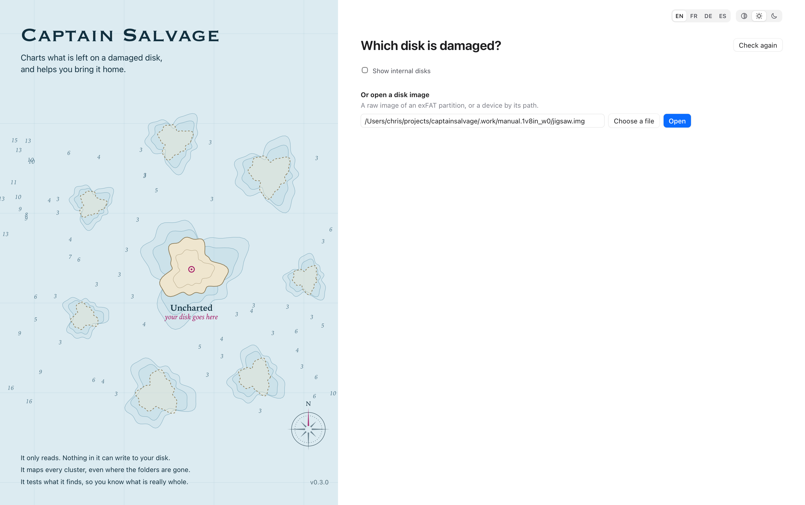

# Captain Salvage

Find the lost treasure on your old, broken drives.

Captain Salvage is a read-only disk recovery tool for macOS. When a repair tool
says a volume is fine but your files are gone, the data is often still there,
with only the links to it cut. This app reads the disk directly, maps what it
finds, and helps you get your files back, without ever writing to the disk.



> **Early development.** Supports exFAT, FAT12, FAT16, FAT32 and NTFS. exFAT has been tested
> on one real damaged volume plus synthetic volumes; FAT-family and NTFS integration are
> tested with synthetic disk images only, so neither has yet recovered a real damaged drive.
> Those images include volumes formatted by `mkfs.fat`, `mkfs.exfat` and `mkntfs` and filled by
> the Linux kernel, whose listings and file hashes the app is compared with in CI. NTFS has
> limits, listed under [NTFS volumes](#ntfs-volumes). Every merged change is a tagged version with notes on the
> [releases page](#releases); no builds are published.

The [illustrated user manual](docs/manual/index.html) shows every part of the app: a safe
first recovery, the Simple and Investigate modes, and a guide to each screen. Open it directly
in a browser; it needs no server or build step. Its screenshots use only synthetic disks.

Screenshots of earlier versions are with their releases in the [changelog](#changelog).

## What makes it different

Most tools give a yes or no. A checksum fails, so the file is gone. Captain Salvage
treats damage as something to route around:

- **It weighs damage.** A damaged entry gets a lower confidence score, not a
  rejection. If it points at a real folder, the trail continues.
- **It shows the whole disk.** The map shows what explains every cluster: a named
  file, a folder, a FAT chain with no name, or nothing yet. Zoom from the whole
  volume down to single bytes.
- **It keeps your theories separate from the disk.** A hypothesis, such as "these
  clusters belong to this file", is an overlay you can switch off. The map
  recalculates, and the disk is never touched.
- **It tests its guesses.** It walks PNG chunks, JPEG markers, MP3 frames and zip
  CRCs through a reassembled file, and reports where the file breaks.
- **It looks inside archives.** Open a zip, tar, tar.gz, tar.xz, tar.bz2, tar.zst, gz, xz,
  bz2, zst, 7z or rar to see its files as a tree, read live from the disk. A file whose name was
  lost is recognised by its first bytes. If a zip has lost its directory, the list is rebuilt
  from the headers of the files inside. A damaged tar lists as far as it can be read. Each
  file can be checked: against its own checksum in a zip, 7z or rar, and against the stream's
  checksum for a compressed file.
- **An AI can investigate with you.** Select anything and ask an agent about it, in the
  Chat with an agent tab: Claude Code, Codex or opencode, with the model you choose. The agent works
  through the same tools as the app, over MCP, and has no write path to the disk.

## Safety

This app never writes to the disk being recovered. That is the rule the design starts from.
macOS can, though, and that can happen before the app is open. See
[Before you plug the disk in](#before-you-plug-the-disk-in).

- Devices are only ever opened read-only, and the read interface has no write method.
- The volume stays unmounted during a scan, because macOS writes to a volume when it mounts it.
- The app checks that the boot regions, FAT, bitmap and root directory still match
  the hash first recorded here. That only covers changes after it was recorded.
- The app follows the kernel's write counter for the disk, and warns if it moves while
  the volume is open. The counter covers the whole disk and has no dates, so it is evidence
  and not proof.
- After a scan, the Overview lists each date the volume's `.Spotlight-V100` and `.fseventsd`
  folders changed, as a record of when macOS last wrote there.
- While the app is open, macOS is told not to put disks to sleep. A damaged old disk can
  drop off USB when woken, and each return lets macOS mount it and write to it again. A
  drive's own firmware may still sleep.
- If the disk is disconnected, the app says so, and stops scans, file tests and copies
  instead of treating failed reads as damage. When the volume comes back under a new disk
  number, the app finds it and warns if macOS has mounted it.
- Copy out refuses any destination on the disk being recovered, including through
  an APFS container, and refuses if it cannot tell which disk a destination is on.
- Copy out never overwrites a file. Each copy is hashed as it is read, then hashed
  again from the destination. The copy report shows every file copied, complete or partial,
  and can read every copy again later to catch one changed or lost since. It reads only the
  destination.
- Only the person using the app can start an export or a Disk Rebuild copy, or choose a
  salvage drive. An AI can plan one, but not start it. The engine refuses every copy-starting
  tool to an agent before it reads the arguments, and none is listed to agents.
- An agent may build and change a Disk Rebuild, which is virtual: its tools write only the
  app's own database, never a source disk. Every change shows in the Rebuild tab marked as made
  by the agent and can be undone (see [Agents building a Disk Rebuild](#agents-building-a-disk-rebuild)).
- While the app is open, macOS cannot mount a volume the person blocked. See
  [Before you plug the disk in](#before-you-plug-the-disk-in).

### Before you plug the disk in

macOS mounts a volume as soon as its disk is attached, and writes to it while it stays
mounted. On one real recovery, a damaged volume stayed mounted for 13 minutes before anyone
unmounted it. In that time macOS changed 36 directory entries, about 0.8 MB, inside
`.Spotlight-V100` and `.fseventsd`, and created files on clusters that had been unclaimed.
Those clusters could have held lost data.

Captain Salvage does not unmount anything itself, because unmounting writes to the disk too.
Set this up before you start:

1. Block mounting. Each volume on the start screen has a **Block mount** checkbox, and on the
   Overview of the open disk **Block mounting while Captain Salvage is open**. While the app is open, macOS refuses
   every mount of a blocked volume: when the disk is plugged in, from Finder, from Disk Utility
   and from `diskutil mount`. It needs no administrator rights and changes nothing on the
   system. When the app quits, macOS mounts as usual again, so plug the disk in only with the
   app open. Volumes you have opened before can be blocked before the disk is attached. A new
   one is mounted once when first plugged in: block it, then unmount it once.

   An `/etc/fstab` line with `noauto` is not enough. On one real recovery, macOS mounted the
   volume about 20 seconds after it was attached, with the line in place.
2. Keep disks awake when the app is closed too. While it is open, it does this for you.

   ```
   sudo pmset -a disksleep 0
   ```

3. Do not run First Aid or `fsck` on it, because both of them write.

If the volume is already mounted, the choice is yours. Staying mounted lets macOS keep writing,
and unmounting flushes pending writes, so both change the disk. One real unmount added 23 write
operations and 98 KB. If the disk keeps dropping off, check the cable and power, and avoid hubs.

An agent can block a volume over MCP, because that only protects it. Only the person using
the app can turn a block off.

### Going back to normal

Turn **Block mount** off for the volume, and set disk sleep back:

```
sudo pmset -a disksleep 10
```

Use the value `disksleep` had before if it was not 10. If you added an `/etc/fstab` line for
the volume with an earlier version, remove it with
`sudo sed -i '' '/^UUID=YOUR-VOLUME-UUID /d' /etc/fstab`.

## One way to open: Open

A disk, a partition, a disk image and a saved scan all open the same way, with one button called
**Open**. The raw source is always loaded first (the byte map is the **Source bytes** tab), with an
interpretation applied to it: the one the last scan of a matching stored source used, otherwise the best
detection from the boot evidence (exFAT, FAT or NTFS, with a confidence), otherwise none, which is
raw bytes only. Opening starts no scan. What is stored loads at once, and a scan runs when you
start it. The source stays read-only, but macOS and other programs may still write to a mounted
disk; the safety precautions above still apply.

The start screen is a tree. Each physical disk is a parent row with its own **Open**, and its
partitions and volumes sit under it, each with its detected filesystem, size, one status, an
inline **Block mount** checkbox and **Open**. A disk whose partition table cannot be read is still
a parent row, with a short note, so its bytes can be opened. What a disk needs (it is mounted, or
reading needs permission) is said once, on its parent row.

**The scope decides which tools show, not how the source opens.** A *partition* (a source that
starts with a volume, a device macOS names as a partition, or one extent of a disk) is narrowed to
one extent, and the filesystem is the first thing shown. A *whole disk* has the layer between bytes
and filesystems: partition bands and evidence lanes on the map, the list of extents with a format
each (hypotheses), **Analyze this range**, and an **Open** for each extent. Opening an extent opens
it as a source of its own, linked to the disk by (parent source, extent): the same partition opened
alone, or seen from its whole disk, is one source with one interpretation and one set of results.

**The interpretation picker** is in the header of an opened partition: `Filesystem: NTFS (detected,
86%)`, listing exFAT, FAT, NTFS and *No filesystem (raw bytes)*. Choosing another makes a new scan
and keeps the earlier one, and the header says so. Choosing the earlier one again opens it without
scanning. A choice with no boot evidence behind it is refused with a reason. **Saved scans** in the
header lists what is stored for the source, each with its interpretation, date, how much it covers,
what it stores, and a name you can edit.

**When a drive matches a stored source**, an exact match opens its latest scan for the last-used
interpretation and starts nothing. A probable match is never applied silently: a question lists the
stored sources by confidence, the changed markers, and their scans, and a scan opens only once you
say you read what changed. Matches under 60% are hidden until **Show all**. **Open as a new source**
applies nothing stored.

Raw sources open in the normal workspace, with the same toolbar, sidebar, overview, and
selection inspector. In **Investigate** mode, the existing disk graph works in byte offsets,
with layers for source bytes, declared MBR/GPT partitions, and filesystem evidence. Nothing
requires a filesystem to be recognised first. Select a partition in the sidebar, drag across
any region of the graph, or enter exact byte offsets in the inspector. **Search for filesystem
evidence** examines that entire range in bounded, pausable batches, including bytes inside
declared partitions. Finding NTFS does not stop the search for older exFAT or FAT structures.
Unreadable ranges are reported separately; unrecognised bytes are never assumed to be empty.

Select evidence or label a region with a suspected format, then **Open** it.
FAT12/16/32 and exFAT interpretations use the existing scan, browse and recovery workflow,
with reads bounded to that region. The label, extent, and boot-metadata selection are saved
with that interpretation's separate recovery workspace, not in the source's partition table.
The **Source bytes** tab returns from an opened filesystem to the whole source and its
discovery findings, without opening a different interface.

Each completed discovery batch saves its findings and checkpoint atomically in
`~/Library/Application Support/Captain Salvage/raw-scans.sqlite`, never on the examined source.
The toolbar shows scan speed and an estimated time remaining after the first batch. Estimates
use the current running period, excluding time spent paused, and may change around slow or
unreadable regions. An interrupted batch is repeated from the last committed checkpoint.

A permanent scan ID identifies the saved analysis. The source is recognised again by markers,
not by one hash: a versioned fingerprint of up to twenty 4 KiB blocks spread over the whole
source (each is 5 percent), each with its own SHA-256. Blank blocks and short repeating patterns
say nothing about which drive this is, so a nearby block is used instead, and a source that is
small or mostly blank gets fewer markers and says so. Opening a disk or a matching raw image
compares each saved marker on its own and reports how many match, how many changed and how many
could not be read (unreadable markers are not counted as changed). The confidence is the matched
markers out of all markers: 17 of 20 is 85%. When markers changed the window says where, for
example "2 of 20 markers changed. Every changed marker is within the first 1 MiB, so a mount
probably wrote metadata." Device numbers, paths and hardware serials are not used as proof of
matching contents.

| State | Markers | What happens |
|---|---|---|
| exact | all match | The latest saved scan loads when the source is opened. A sampled match does not prove every byte is identical. |
| probable | 60% or more (12 of 20) | Opening needs an explicit acknowledgement of the changed markers. The scan records that it resumed on a changed source and the offsets that changed, and the regions around them are marked as possibly out of date until they are scanned again (see below). |
| weak | under 60%, with at least 8 matching markers | Listed only with **Show all**. It never loads. |
| different | fewer than 8 matching markers, or another length | Never listed and never loads. A different length is a different scope, not a changed drive. |

A saved source below 60% is hidden by default; **Show all** (`--show-all`, `showAll`) lists the weak
ones too. At least 8 markers must match before any match is reported, so two drives that share a
few blocks, or a drive with most markers unreadable, are not mistaken for each other. A source
with fewer than 8 usable markers needs all of them to match. Markers are read once each, with a
time limit, and reading stops after five failed reads in a row, so a failing drive is not
hammered. Fingerprints saved by earlier versions (sixteen samples) are compared marker by marker
over their own count.

Reopen the disk or a matching raw image: its latest scan loads by itself (a probable match asks first), then choose **Resume scan**.
Multiple scan IDs can analyse different ranges of the same contents. A scanner-version mismatch
also requires a new scan. Previous read failures are retained as source-specific evidence, not
attributed to a clone: loading rewinds to retry those regions, and successful rereads clear the
outstanding failures. Sources with no usable marker can still be scanned and saved, but cannot be
recognised after reopening. Scans made by older versions without these checkpoints cannot be
recovered after that older app closes.

The CLI uses the same saved scans:

```sh
captainsalvage disk /path/to/disk.img --scan
captainsalvage disk /path/to/clone.img --list-scans [--show-all]
captainsalvage disk /path/to/clone.img --resume SCAN_ID --accept-sampled-match [--accept-changed-markers]
```

New scans may specify `--offset BYTES --length BYTES`; resumed scans always use their saved range.

A surviving exFAT backup boot region can supply an in-memory interpretation when the main
boot region has been overwritten, for example by NTFS. The same holds for NTFS: the copy of
its boot sector in the volume's last sector, one sector past the end of the volume, can stand
in for a main boot sector that was written over. Pass that sector's offset as the boot
evidence. The original bytes remain available in the raw view and are not repaired or
replaced on disk. This requires enough surviving metadata and valid geometry: isolated
directory entries are evidence, not proof of a complete volume or enough information to
locate every file. Candidate extents may overlap; these are hypotheses, not claims that the
disk's current partition layout is wrong.

The initial probes recognise FAT boot geometry, exFAT boot regions and checksummed directory
entry sets, NTFS boot sectors and their backups, and BitLocker boot sectors, which are
reported as encrypted and not readable. The ext4, Btrfs, and bcachefs probes are not
implemented yet. Extended MBR chains and backup-GPT recovery are also not
implemented; unsupported or invalid tables produce warnings without preventing raw access.

## Analyzing a selected range

When a region of a raw source holds something you cannot name, select it and choose **Analyze
this range** in the selected-region panel. The analysis asks every filesystem driver the app has
(exFAT, FAT12/16/32 and NTFS, plus detection of BitLocker) one question at every start offset it
tries: how much of this range decodes if the structures start here? Each driver answers by decoding
from that offset, and the report lists, per driver, the offset where the most decodes, and a list
of findings. A finding has the format, the offset, how many bytes decoded, and a confidence
(high, medium or low, with the number behind it).

- **The slide does not need a signature.** Boot sector identifiers and the `FILE` record magic are
  only the cheap way to reject nearly every offset at once, and they raise confidence. Turn them
  off (`--no-signatures`, or `signatures: false`) and the structural decoders still find FAT
  directory entries by the shape of their names, dates and sizes, and NTFS MFT records by their
  update sequence array and attribute chain, even where the magic was overwritten. A record whose
  magic is gone is reported as such, with a lower confidence.
- **Every offset is tried, up to a size.** Offsets are counted from byte zero of the source, so a
  structure aligned in the source is met wherever the range starts. Ranges up to 128 MiB slide one
  byte at a time, so structures at odd offsets are found. Larger ranges slide 32 bytes at a time,
  which still meets every directory entry, record and boot sector that sits on a sector boundary;
  the report says so, and `--step 1` forces every offset. One analysis reads at most 2 GiB. Analyze
  a larger source in pieces.
- **Identified data that cannot be decoded is kept as an island.** A directory with no boot
  sector, a boot sector whose volume does not open, an encrypted volume: each is reported as
  *identified, not placed in a volume* with what is missing, and an offer to search for the missing
  metadata. **Search for missing metadata** analyzes a margin of up to 256 MiB around the island
  for only that driver, which finds, for example, a boot sector or a backup one nearby.
- **A volume is only "opens as a volume" when it opens.** A boot sector that decodes is tested by
  opening the volume read-only and listing its root. NTFS and exFAT backup boot sectors are used
  when the main one fails. A FAT boot sector, which is plain numbers with no checksum, starts at a
  low confidence and is raised only when the volume opens.
- **NTFS geometry can be inferred.** The `$MFT` record describes the MFT's own runs and allocated
  size, so the cluster size and where the volume must start follow from one surviving record. The
  proposal is tested by opening the volume with a boot sector rebuilt in memory; if the root lists,
  the finding is *opens with rebuilt geometry*. Where the records lost their magic, the proposal is
  reported with a low confidence and not opened. Inference for FAT and exFAT, whose directories
  do not hold their own geometry, is not done.

```sh
captainsalvage range analyze /path/to/image.img --offset 1048576 --length 268435456
captainsalvage range analyze /path/to/image.img --no-signatures --format FAT
```

The MCP tool `captainsalvage_analyze_range` takes the same options and gives the same answer.
Findings are evidence, not proof: a plausible run of FAT directory entries can occur by chance
in data that is not FAT, which is why a lone short run is not reported and every result carries a
confidence. Compressed or encrypted data is not decoded, and BitLocker volumes are only
recognised. ext4, Btrfs and bcachefs are not probed yet. Analysis only reads, through the same
read-only handle every raw operation uses, and a source's hash is unchanged by it.

## Hypotheses and virtual layouts

A guess about what a stretch of the source holds is saved as a **hypothesis**: an extent (start
and end), a format (exFAT, FAT12/16/32 or NTFS) and a confidence. Save one from an analysis
finding with **Save as hypothesis**, which carries over the finding's extent, boot evidence and
confidence, or save the current selection. The right panel lists them under **Hypotheses**.

- **Hypotheses overlap and compete.** Each is a layer with an on/off switch. Where enabled
  extents overlap, the highest layer is the one read; the list says which layer is on top of how
  many others. Switching a layer off, or putting another on top, deletes nothing. **Open**
  opens a hypothesis as a filesystem through the same read-only path as any
  interpretation.
- **Start and end are yours to set.** Type them, or drag across the map and choose **Use the
  selection**. A moved extent drops boot evidence that no longer lies inside it.
- **A hypothesis is a segment of an overlay.** Like a Disk Rebuild, a layout is an ordered set of
  segments: a range of the source and where it sits in a virtual device, which is the segment's
  start unless you set it elsewhere. Where enabled segments overlap in the virtual device the
  upper layer is read and the layers below show through where it does not reach. Virtual bytes no
  segment covers are refused when read, never returned as zeros. A **virtual partition table** is
  a layout whose segments are partitions, listed by their position in the virtual disk with
  overlaps and gaps marked. It is a view kept by the app. It is never written to the disk.
- **Nothing is written to the source.** A segment only names a range of a read-only source, and
  the overlay has no write path. Hypotheses are saved on this Mac in the same database as raw
  scans (`raw-scans.sqlite`), keyed by the source's sampled fingerprint, so a clone or image with
  the same contents finds them again and another source does not.

```sh
captainsalvage hypothesis save /path/to/image.img --format NTFS --start 1048576 --length 8388608 --confidence 0.8
captainsalvage hypothesis update /path/to/image.img --id ID --start 1049088 --disabled
captainsalvage hypothesis list /path/to/image.img
captainsalvage hypothesis read-layout /path/to/image.img --offset 0 --length 512
```

MCP offers the same operations as `captainsalvage_save_hypothesis`, `_update_hypothesis`,
`_delete_hypothesis`, `_raise_hypothesis`, `_list_hypotheses`, `_open_hypothesis` and
`_read_layout`. Limits: a hypothesis is a claim and carries no proof, and its confidence is only
what its finding or its author gave it. A layout is read through the app's tools; it is not
mounted, and no other program sees it. A hypothesis with a virtual position other than its own
start can be read in the layout, but **Open** opens the extent where it lies in
the source. Layouts of several unrelated filesystems are not merged into one filesystem.

## What each filesystem supports

exFAT, FAT12, FAT16, FAT32 and NTFS volumes open in one workspace with the same read-only rules.
The table below is the one the window, `captainsalvage filesystem capabilities SOURCE`, the engine
tool `capabilities` and MCP's `captainsalvage_capabilities` report, and a test fails when this
block differs from it, so the README cannot claim more than the app reports. **Not offered**
means the feature does not exist for that filesystem (FAT has no alternate data streams). It is
not the same as **Missing**, which exists but is not done yet. NTFS has its own section below.

<!-- capabilities:start -->
| Feature | exFAT | FAT12, FAT16, FAT32 | NTFS | SquashFS | ext2/3/4 | EROFS |
|---|---|---|---|---|---|---|
| Open | Supported | Supported | Supported | Supported | Supported | Supported |
| Scan | Supported | Supported | Supported | Limited | Supported | Limited |
| Map | Supported | Supported | Supported | Limited | Limited | Limited |
| Browse | Supported | Supported | Supported | Supported | Supported | Supported |
| Preview | Limited | Limited | Limited | Limited | Limited | Limited |
| Resume | Supported | Supported | Supported | Supported | Supported | Supported |
| Baseline copy | Supported | Supported | Supported | Supported | Supported | Supported |
| File tests | Supported | Supported | Limited | Supported | Supported | Supported |
| Disk Rebuilds | Supported | Supported | Limited | Limited | Supported | Supported |
| Copy out | Limited | Limited | Limited | Limited | Supported | Limited |
| Mount block | Supported | Supported | Limited | Missing | Missing | Missing |
| Named streams | Not offered | Not offered | Limited | Not offered | Not offered | Not offered |
| Hard links | Not offered | Not offered | Supported | Not offered | Not offered | Not offered |
| Attribute lists | Not offered | Not offered | Missing | Not offered | Not offered | Not offered |
| Compression | Not offered | Not offered | Supported | Not offered | Not offered | Not offered |
| Encryption | Not offered | Not offered | Missing | Not offered | Not offered | Not offered |
| Journal | Not offered | Not offered | Missing | Not offered | Not offered | Not offered |
| Large volumes | Not offered | Not offered | Limited | Not offered | Not offered | Not offered |

**exFAT**

- Open (Supported): Boot sector, FAT and allocation bitmap are read and saved as a baseline.
- Scan (Supported): Every cluster is read once for directory entries; resumable.
- Map (Supported): Allocation, content, ownership and confidence layers.
- Browse (Supported): The folder tree is rebuilt from directory clusters.
- Preview (Limited): Bytes are read through the FAT chain, or contiguously where the entry says so. A cluster that cannot be read is marked: the text and byte previews show each of its bytes as ?, and name the range; an image or a film shows it as zeros.
- Resume (Supported): A paused or interrupted scan continues from its last saved cluster.
- Baseline copy (Supported): Boot regions, FAT, bitmap and root are hashed and kept; changes are explained.
- File tests (Supported): File formats are walked through the reassembled bytes.
- Disk Rebuilds (Supported): Disk Rebuilds overlay cluster lists and folder links without touching the disk.
- Copy out (Limited): Copies are hashed, never overwrite, and record complete or partial status. A cluster that cannot be read is written as zeros, so the file keeps its layout, and the copy is marked partial; the manifest names the unreadable byte ranges.
- Mount block (Supported): macOS is refused a mount of the volume while the app is open.

**FAT12, FAT16, FAT32**

- Open (Supported): The boot sector, the reserved sectors, the FAT copies and the root directory are read and saved as a baseline. FAT12, FAT16 and FAT32 are told apart by their cluster count. FAT has no allocation bitmap on disk. Checked on synthetic images and by the driver's independent tests, not yet on a real damaged drive. The entries are read through the FAT driver's generic layers adapter, which the driver's own checks cover; the old FAT adapter stays for one release (set SALVAGE_FAT_ADAPTER=legacy) and reads a volume the driver does not open.
- Scan (Supported): Every cluster is read once for directory entries, deleted ones included; a deleted entry has lost the first character of its name and its chain is cleared. FAT12 and FAT16 keep a fixed-size root directory that is scanned apart from the data clusters; the FAT32 root is a chain. Resumable. An entry in a cluster that is free in the FAT is deleted, as the driver reads it. A file's clusters are the driver's walk of what its entry claims: its FAT chain, and, for a deleted file, whose chain the FAT cleared, one run from its first cluster, which is a guess and is marked as one (the file is copied whole, from the guess, instead of one cluster). An entry the driver found by its content only, not through a folder that names it, is a weak candidate: marked unchecked, and lone_entry when it is the only entry in its cluster, with half the confidence.
- Map (Supported): A cluster is allocated when its FAT entry is not zero, because there is no bitmap to read. Content, ownership and confidence layers.
- Browse (Supported): The folder tree is rebuilt from directory clusters and the fixed root of FAT12 and FAT16. A long name is used only when its checksum agrees with its short name.
- Preview (Limited): Bytes are read through the FAT chain. A deleted file's chain is cleared, so it is partial unless the person turns on the contiguous-fallback hypothesis, which assumes the clusters after the first follow it. A cluster that cannot be read is marked: the text and byte previews show each of its bytes as ?, and name the range; an image or a film shows it as zeros.
- Resume (Supported): A paused or interrupted scan continues from its last saved cluster.
- Baseline copy (Supported): The boot sector, the reserved sectors, every FAT copy and the root directory are hashed and kept, and a changed copy of a FAT32 table is reported; changes are explained.
- File tests (Supported): File formats are walked through the reassembled bytes.
- Disk Rebuilds (Supported): Disk Rebuilds overlay cluster lists and folder links without touching the disk.
- Copy out (Limited): Copies are hashed, never overwrite, and record complete or partial status. A cluster that cannot be read is written as zeros, so the file keeps its layout, and the copy is marked partial; the manifest names the unreadable byte ranges.
- Mount block (Supported): macOS is refused a mount of the volume while the app is open.

**SquashFS**

- Open (Supported): The volume opens for salvage, from a backup of its geometry when the first is damaged.
- Scan (Limited): Every record is found, live, deleted or damaged, and damaged ones are kept as evidence. The driver lacks deleted-candidates.
- Map (Limited): The driver gives no allocation, so every cluster of the map is allocation unknown, which is not free and not in use. Content and ownership layers.
- Browse (Supported): The folder tree is rebuilt from the parent claims of the records. A symbolic link is listed as a file that holds its target, and a special file as an empty one.
- Preview (Limited): Bytes are read through the driver, which decodes compressed blocks and fragment tails. A range that cannot be read is marked, as for the other filesystems.
- Resume (Supported): A paused or interrupted scan continues from where it was.
- Baseline copy (Supported): The volume's first structures (its superblock) are hashed and kept; changes are explained.
- File tests (Supported): File formats are walked through the bytes the driver reads.
- Disk Rebuilds (Limited): A rebuild is a plan of ranges of the source. The driver lacks cluster-steps. A Disk Rebuild gathers the folders and files the scan found (a file the disk lost the name of can be named by an accepted entry) and copies them out at their rebuilt paths. A file's storage is the driver's walk of it, so a Disk Rebuild cannot replace it with a list of clusters. A link is read by its path in the volume's own namespace, so one whose folders are lost cannot be copied.
- Copy out (Limited): A file is rebuilt from the storage it claims, and a range that cannot be read is zeros, marked in the report. The driver lacks deleted-extents.
- Mount block (Missing): macOS does not mount this filesystem, so there is nothing to block.

**ext2/3/4**

- Open (Supported): The volume opens for salvage, from a backup of its geometry when the first is damaged.
- Scan (Supported): Every record is found, live, deleted or damaged, and damaged ones are kept as evidence.
- Map (Limited): The driver gives no allocation, so every cluster of the map is allocation unknown, which is not free and not in use. Content and ownership layers.
- Browse (Supported): The folder tree is rebuilt from the parent claims of the records. A symbolic link is listed as a file that holds its target, and a special file as an empty one.
- Preview (Limited): Bytes are read through the driver, which decodes compressed blocks and fragment tails. A range that cannot be read is marked, as for the other filesystems.
- Resume (Supported): A paused or interrupted scan continues from where it was.
- Baseline copy (Supported): The volume's first structures (its superblock) are hashed and kept; changes are explained.
- File tests (Supported): File formats are walked through the bytes the driver reads.
- Disk Rebuilds (Supported): A rebuild is a plan of ranges of the source. A Disk Rebuild gathers the folders and files the scan found (a file the disk lost the name of can be named by an accepted entry) and copies them out at their rebuilt paths. A file's storage is the driver's walk of it, so a Disk Rebuild cannot replace it with a list of clusters. A link is read by its path in the volume's own namespace, so one whose folders are lost cannot be copied.
- Copy out (Supported): A file is rebuilt from the storage it claims, and a range that cannot be read is zeros, marked in the report.
- Mount block (Missing): macOS does not mount this filesystem, so there is nothing to block.

**EROFS**

- Open (Supported): The volume opens for salvage, from a backup of its geometry when the first is damaged.
- Scan (Limited): Every record is found, live, deleted or damaged, and damaged ones are kept as evidence. The driver lacks deleted-candidates.
- Map (Limited): The driver gives no allocation, so every cluster of the map is allocation unknown, which is not free and not in use. Content and ownership layers.
- Browse (Supported): The folder tree is rebuilt from the parent claims of the records. A symbolic link is listed as a file that holds its target, and a special file as an empty one.
- Preview (Limited): Bytes are read through the driver, which decodes compressed blocks and fragment tails. A range that cannot be read is marked, as for the other filesystems.
- Resume (Supported): A paused or interrupted scan continues from where it was.
- Baseline copy (Supported): The volume's first structures (its superblock) are hashed and kept; changes are explained.
- File tests (Supported): File formats are walked through the bytes the driver reads.
- Disk Rebuilds (Supported): A rebuild is a plan of ranges of the source. A Disk Rebuild gathers the folders and files the scan found (a file the disk lost the name of can be named by an accepted entry) and copies them out at their rebuilt paths. A file's storage is the driver's walk of it, so a Disk Rebuild cannot replace it with a list of clusters. A link is read by its path in the volume's own namespace, so one whose folders are lost cannot be copied.
- Copy out (Limited): A file is rebuilt from the storage it claims, and a range that cannot be read is zeros, marked in the report. The driver lacks deleted-extents.
- Mount block (Missing): macOS does not mount this filesystem, so there is nothing to block.
<!-- capabilities:end -->

What each was checked against, apart from this app's own synthetic images:

- **exFAT** was used on one real damaged volume. The `rust-fs-exfat` driver compares listings and
  every file's SHA-256 with the macOS driver and `fsck_exfat` on images macOS formatted, and with
  the Linux kernel and exfatprogs on images they formatted and filled. The app does not yet read
  an independently formatted exFAT image in its own tests.
- **FAT12, FAT16 and FAT32** are one family in one driver, `rust-fs-fat` (package `rust-fs-fat32`).
  Its tests build images with `mkfs.fat`, fill them through the Linux kernel's vfat driver and
  compare listings, bytes and cluster chains with `mtools`, including fragmented files, deleted
  entries and damage recipes graded by `fsck.fat`. This app reads hand-built synthetic images
  only. Not checked yet by anyone: a partition at an offset, 4096-byte sectors, volumes over
  40 MiB, damaged FATs beyond one truncated chain, directory loops, cross-linked chains and real
  damaged drives.
  The app reads FAT entries through that driver's three layers (`filesystem::generic`), and
  adopts what it says: an entry in a cluster that is free in the FAT is deleted, and an entry it
  found by its content only (not through a folder that names it) is a weak candidate, marked
  `unchecked`, or `lone_entry` when it is the only entry in its cluster, at half the confidence.
  A file's clusters come from the driver's walk of what its entry claims: its FAT chain, and for a
  deleted file, whose chain the FAT cleared, one run from its first cluster, which is a guess: its
  verdict says so and has the guessed-extent confidence, its copy is whole and marked `extentsGuessed`
  in the manifest, and the file tests run on it as on any other (the old adapter copies one cluster).
  The app's earlier FAT adapter stays for one release: set `SALVAGE_FAT_ADAPTER=legacy` to read
  with it, and it reads a volume the driver does not open.
- **NTFS** is checked against ntfs-3g, the Linux kernel's ntfs3 and volumes Windows formatted,
  as described in the next section. No real damaged NTFS drive has been recovered yet.

## NTFS volumes

NTFS opens in the same workspace as exFAT and FAT, with the same read-only rules: the app
never writes to the volume, never replays its journal onto it, and never repairs its
metadata in memory and shows the result as if it were on the disk. The NTFS driver
(`rust-fs-ntfs`) decodes every structure; the app only turns what it returns into entries,
a map and a baseline. The window, `captainsalvage filesystem capabilities SOURCE`, the engine
tool `capabilities` and MCP's `captainsalvage_capabilities` all report the table below from
one place, so none of them can claim more than the adapter does.

| Feature | Status | What it means for NTFS |
|---|---|---|
| Open | Supported | The boot sector, `$MFT`, `$Volume`, the root directory record and `$Bitmap` are read and kept as the volume's baseline, with the boot sector's backup, and the baseline says which of them could not be read. A BitLocker volume is refused by name after one sector is read. A volume whose `$Bitmap` cannot be read still opens, with its allocation unknown (below), and a `$MFT`, `$Volume` or root record that fails its update-sequence check is reported as damage in words, never silently. `$MFTMirr` is not consulted yet. |
| Scan | Supported | Every cluster is read for FILE records, so deleted files, old copies of the MFT and files whose folders are gone are found as well as live ones. A record that fails its update-sequence check is kept as a damaged entry and never read as a file. Resumable. |
| Map | Supported | Allocation comes from `$Bitmap`. Clusters holding FILE records show as directory structure. The first two clusters, which hold the boot sector and its code, are not drawn: they are covered by the baseline. When `$Bitmap` cannot be read, every cluster is drawn as *allocation unknown*, a state of its own that is neither free nor in use; verdicts never call such a cluster free or overwritten, and the unexplained-space totals do not count it as free (it is counted apart). |
| Browse | Supported | The tree is rebuilt from each record's parent reference. A folder whose own record was lost is listed with no name, as an exFAT folder is. A name linked under a parent whose sequence number has since changed gets a lower link confidence. |
| Preview, tests | Limited | Resident, fragmented, sparse, deleted and NTFS-compressed (LZNT1) data is read through the driver, including named streams. EFS-encrypted, incomplete and otherwise unsupported streams are listed with their size and cannot be read. Those streams are errors that say why, never zeros. A stretch of a stream held in runs that cannot be read (a damaged or missing run, a run outside the volume, a failed read, a compression unit that does not decode) is marked: the text and byte previews show each of its bytes as ?, and name the range. Only that stretch, the zeros NTFS defines (sparse holes and bytes past the initialised length) and nothing else read as zeros. |
| Resume | Supported | Same checkpoints as exFAT. |
| Baseline copy | Supported | Clusters written since the baseline are reported, and a changed volume is read through the saved structures. |
| Disk Rebuilds | Limited | A rebuild can replace a file's clusters or a folder's parent and is read as clusters. A record, its names and its run list are never altered. |
| Copy out | Limited | Hashed, never overwrites, complete or partial. A stretch of a stream held in runs that cannot be read is written as zeros, so the file keeps its layout, and the copy is marked partial; the manifest names the unreadable byte ranges. A stream that cannot be read at all (encrypted, compressed in a way this does not decode, incomplete, or a record that changed) is reported failed, writes no file and is never filled with zeros. |
| Mount block | Limited | The block is set by volume UUID when macOS gives one, which it does for a real NTFS volume on a drive. When it gives none (it gives none for a synthetic NTFS image, bare, in an MBR partition or in a GPT partition, checked on throwaway images), the volume is blocked by where it is: the identity of the disk (the device's own GUID, or, for a disk that has none such as a disk image, a hash of its first 4 KiB) with the partition's offset and length. A disk with no GUID whose start is rewritten, or a partition that is moved or resized, is no longer recognised as blocked. The Block mount checkbox appears for both. macOS mounts NTFS read-only itself; only a third-party NTFS driver would write. |
| Alternate data streams | Limited | Each named stream is an entry of its own, named `file:stream`, with its own size, and is read and copied as exactly its bytes, never merged into the file. A stream that is encrypted, compressed in a way this does not decode or incomplete is listed and fails to copy, never filled with zeros. A file whose attributes continue in extension records has its streams listed once each, resolved through the driver; a rescan keeps each stream's entry and does not duplicate it. Checked on synthetic images; the sizes and bytes are not yet compared with what Windows reports, so the row stays limited. |
| Hard links | Supported | A file with several names is listed under each, in the folder the name belongs to, with the file's size and bytes, and a copy holds it under every name. Each name is an entry of its own, told apart from the others by its place in the record's names, so a rescan does not duplicate it. |
| Attribute lists, journal | Missing | A file whose attributes continue in extension records is listed with its named streams (read through the driver), but its unnamed data is not read from the extension records ([rust-fs-ntfs#1379](https://github.com/antimatter-studios/rust-fs-ntfs/issues/1379)). `$LogFile` and `$UsnJrnl` can be read as a separate, labelled interpretation that is never part of the entries and never written (`captainsalvage_ntfs_journal_evidence`, and `captainsalvage filesystem journal` below), but the window does not show it and it is not yet checked against Windows' own volumes, so the row stays missing. |
| Compression | Supported | An LZNT1-compressed file is read: each compression unit is mapped to its clusters here and decoded by the driver. Checked on synthetic images (the units laid out as NTFS does, read back whole, in pieces and copied, and a unit that does not decode marked) and on volumes Windows compressed files on (512, 1024 and 4096-byte clusters), each file with the SHA-256 Windows reports. |
| Encryption | Missing | EFS files are listed and marked unreadable. BitLocker volumes are refused. |
| Very large volumes | Limited | Up to 4,294,967,294 clusters (2^32 - 2), which is 16 TiB with 4 KiB clusters. Windows itself does not create or mount a volume with more, so a boot sector that states more is refused at open, with that reason, before anything else is read. |

A live deleted file keeps its bytes only while its clusters are untouched: a surviving FILE
record is evidence, not proof, that the clusters were not reused, and the verdicts say so. A
file whose bytes are stored inside its own FILE record has no cluster that could have been
reused, so it is read as it survived.

The `in use` flag of an NTFS entry means its record says it is in use *and* its record sits
in a cluster `$Bitmap` calls allocated. An in-use record in a free cluster is an old copy of
the MFT and is shown as not in use.

What was checked against something that is not this app:

- **ntfs-3g and the Linux kernel's ntfs3**, in the Linux test VM (`chore test:oracle`, from
  `tests/ntfs_oracle.rs` and `validation/oracle.sh`). For images the rust-fs-ntfs driver
  formatted and wrote, `ntfsfix -n` finds nothing, and `ntfsls` and `ntfscat` agree with a
  read-only ntfs3 mount about every path, size and SHA-256, including an alternate data stream.
  The app's scan, browse and read report the same tree and the same hashes, every live file is
  called live, and what the app copies is byte for byte what the oracles read. For images the
  oracles' own tools made (`mkntfs` at 512 and 4096 byte clusters, filled through a read-write
  ntfs3 mount: 150 files in one folder, a sparse file, a fragmented file, non-ASCII names), the
  app lists exactly what ntfs3 and ntfs-3g list, and reads files they deleted through ntfs-3g.
  The two oracles are compared with each other first, and the script fails if they differ.
- **mkfs.fat, mkfs.exfat and the Linux kernel's vfat and exfat**, in the same VM (from
  `tests/fat_exfat_oracle.rs` and `validation/fat-oracle.sh`). The formatters make twelve images
  (FAT12 at 512 and 4096 byte sectors and 60 MiB, FAT16 at 512 and 4096 byte sectors, FAT32 at 512
  and 4096 byte sectors, exFAT at 512 and 4096 byte sectors, and a FAT16, a FAT32 and an exFAT
  volume at a 1 MiB offset in a disk with a partition table), the kernel fills them through a
  read-write mount, and the kernel, mtools (FAT) and `fsck` report them. The app lists exactly what
  the kernel lists, with the same SHA-256 for every file, copies the same bytes, finds the two files
  written last and deleted, and leaves the image unchanged. Damaged copies (zeroed FAT, cut, looping
  and cross-linked chains, differing FAT copies, a wrong exFAT checksum) are ones `fsck` rejects, and
  the app never calls a file live with bytes the kernel did not read.
- **mksquashfs and the Linux kernel's squashfs**, in the same VM (from `tests/squashfs_oracle.rs`
  and `validation/squashfs-oracle.sh`). `mksquashfs` makes seven images of one tree (every
  compressor the format has, gzip, xz, lzo, lz4 and zstd, at 128 KiB blocks, and gzip at 4 KiB and
  1 MiB blocks: files of one block and of several, a tail kept in a fragment, a file with holes,
  an empty file, 400 entries in one folder, non-ASCII and long names and symbolic links), and the
  kernel mounts them read-only. Through the generic layers adapter over the rust-fs-squashfs
  driver, the app lists exactly the folders, files and links the kernel lists, with the same
  SHA-256 for every file and the same target for every link, and copies every file from the
  storage its record claims with the kernel's bytes. The app does not open a SquashFS image in a
  window yet: this checks the driver and the adapter it will be opened through.
- **mke2fs, e2fsck and the Linux kernel's ext4**, in the same VM (from `tests/ext4_oracle.rs` and
  `validation/ext4-oracle.sh`). `mke2fs -d` makes eight images of one tree (ext4 at 4 KiB and 1 KiB
  blocks, ext3 at 4 KiB and ext2 at 4 KiB and 1 KiB, the last three mapping files by indirect
  blocks, and ext4 again with small files stored in their inodes, with the older feature set
  (no 64-bit, checksums, journal or flex groups) and with linear directories: files of one block and of several, a file with holes, an empty file, 400 entries in one
  folder, non-ASCII and long names and symbolic links), `e2fsck` calls each clean, and the kernel
  mounts them read-only. The app opens each as a person does, scans and browses it, reads every
  file in full and copies it out, and what it shows and copies is exactly the kernel's tree: the
  same folders and files, the same SHA-256 for every file, and a link as a file that holds its
  target.
- **mkfs.erofs and the Linux kernel's erofs**, in the same VM (from `tests/erofs_oracle.rs` and
  `validation/erofs-oracle.sh`). `mkfs.erofs` makes five images of one tree (uncompressed, chunk-based
  files, LZ4 and LZ4HC compressed, and LZ4HC with the tail of a file packed into its inode: files of
  one block and of several, a file with holes, an empty file, 400 entries in one folder, non-ASCII
  and long names and symbolic links), and the kernel mounts them read-only. The app opens each as a
  person does, scans and browses it, reads every file in full and copies it out, and what it shows
  and copies is exactly the kernel's tree: the same folders and files, the same SHA-256 for every
  file, and a link as a file that holds its target.
- **Windows itself**, in the Windows 11 guest of
  [fs-windows-test-harness](https://github.com/antimatter-studios/fs-windows-test-harness)
  (`chore test:windows-oracle`, from `tests/ntfs_windows.rs` and `validation/windows/`), or on a
  hosted Windows runner (the opt-in `windows-oracle` workflow). Windows formats six NTFS volumes
  with `Format-Volume`: 24 MiB at 512, 1024 and 4096 byte clusters, 96 MiB on a disk with
  4096-byte sectors, and 320 MiB at 4096 and 65536 byte clusters. Windows fills each with a fixed
  tree through its own file system: nested folders and a path of more than 260 characters, 400
  files in one folder (1200 on the large volumes) and 150 files with 120-character names in another, names in Latin,
  Cyrillic, Greek, Hebrew, Japanese and Chinese, an emoji, a decomposed accent and names at the
  255-character limit, each with the 8.3 name Windows made for it, files either side of the
  cluster size, files written in turns so they are fragmented, sparse files, alternate data
  streams on files and on a folder, compressed files, hard links, a junction and two symlinks,
  and files and a folder it deleted last. Windows' own `chkdsk` finds no problem in any of them,
  and `Get-ChildItem`, `Get-FileHash` and `fsutil` report what each holds. The app reads the
  images and must give the same answer:
  - **Listing and content.** The app lists the same 616 files and 38 folders (1416 files on the
    320 MiB volumes) with the same size and SHA-256 for every file, nothing more and nothing
    less, and calls them live. Files Windows lists but never follows (the junction and the
    symlinks) are listed.
  - **Records.** Every alternate stream Windows lists, with its length, is in the app's record
    of that file or folder; every 8.3 name Windows made is among the record's names; the number of
    extents `fsutil` reports for each file that is not compressed is the number of runs the app
    finds; and the sparse
    and compressed flags agree.
  - **Deleted files.** The app finds the files Windows deleted, at their old paths, and reads
    back every byte. Windows leaves nothing of a small deleted file that is held inside its own
    record (the generator searches the whole volume for its first bytes), so none is found and
    none is invented.
  - **Copy.** What the app copies is, byte for byte, what Windows hashed, and the files Windows
    lists with no bytes are copied empty.
  - **Not written.** The image's hash is the same afterwards and the baseline check agrees.

  What the app does not do, as these volumes show it, is pinned in the test by an issue each, and
  the test fails if one of them stops being true: content of alternate streams is not read by the
  app, so only their names and lengths are compared. A volume on **4096-byte sectors**, whose file
  records Windows makes 1024 bytes long
  ([#177](https://github.com/antimatter-studios/captainsalvage/issues/177)), is opened and compared
  like the others.
- **The independent [`ntfs`](https://crates.io/crates/ntfs) reader**, a dev-only dependency
  never linked into the app, for every live file of the driver's images (`tests/ntfs.rs`).

The oracles found two faults, each fixed behind a failing test. Records the Linux ntfs3 driver
writes carry no record number where the driver looked for one (rust-fs-ntfs#1380), so their
folders could not be told apart; the driver now reads the number only where the header has one,
and the app takes it from where `$MFT` places the record. And a live file stored inside its own
record was called only plausible, so the copy planner left it out.

Windows' volumes found two more, each fixed behind a failing test. Windows sets the compression
flag on the data of a small file in a compressed folder, although it holds those bytes
uncompressed in the file's record, and the app called such a file unreadable and left it out of
copies. And a name longer than the destination allows was cut at its end, so a long name lost its
extension when copied.

Not checked: a live NTFS mount, the window tests, a real damaged NTFS drive, reparse points
followed to their targets, EFS-encrypted files, `$Extend` metadata, a volume with a damaged
`$LogFile`, and a whole disk with a partition table written by Windows (the images are the
volume alone). A volume a kernel or ntfs-3g has deleted a file from through ntfs3 keeps nothing
to recover, because ntfs3 scrubs the name; files deleted through ntfs-3g keep their records. A
small file Windows deletes keeps nothing either, and a larger one keeps its record and clusters
until they are reused.

## How far to trust the results

Confidence scores are estimates. Testing on one real damaged volume found:

| Test | Result |
|---|---|
| PNG files, checksums on every chunk | 25 of 25 fully valid |
| JPEG files, structure only, because JPEG has no checksums | 25 of 25 at least 99.99% valid |
| Zip archives, CRC on every member | 6 of 7 fully valid |
| A 1.1 GB film in 4,042 pieces, full decode | Decoded, with frames checked by eye |

The seventh zip had been scored at 100% confidence, yet one of its 376 members fails
its CRC. Bad data inside a file can look perfect from the outside, so test or open
what matters. Nothing is recovered until it is safely on another disk and you have
checked it. Some files will not come back.

## Development setup

These instructions build and install Captain Salvage from source. You need macOS, Rust
and Node.js.

```sh
npm install
npm run app
npm run install:user
open "$HOME/Applications/Captain Salvage.app"
```

`npm run install:user` copies the build into `~/Applications`, for this user only.
`npm run install:system` copies it into `/Applications`, for everyone on the Mac, and needs an
administrator account. Either replaces the copy already there, and stops if that copy is
running. To try a build without installing it, open
`target/release/bundle/macos/Captain Salvage.app`.

### Building Finder support

The optional Finder File Provider extension is included only in a team-signed build with
provisioning profiles for both the app and extension. Keep the signing key, certificate and
profiles outside the repository. Set their paths when building and installing:

```sh
CS_SIGN_KEY=development.key.pem CS_SIGN_CERT=development.cer.pem \
CS_APP_PROFILE=app.provisionprofile CS_EXT_PROFILE=fileprovider.provisionprofile \
  npm run app
npm run install:user
```

Without these credentials, the app still builds and runs, but does not offer Finder support.
Use the same signing identity for later builds so macOS and network filters such as Little
Snitch continue to recognise the app. Installing also removes the separate "Captain Salvage
Finder" app used by earlier versions.

**First, keep the damaged volume unmounted, and don't run First Aid or `fsck` on it.**
A repair may be what made your files disappear, and it could overwrite what is left.

```sh
diskutil list                          # find the disk, such as disk4s2
diskutil unmount /dev/disk4s2
sudo chgrp staff /dev/rdisk4 /dev/rdisk4s2
```

The last command gives your account read-only access to the raw device until the disk
is reconnected. Reconnecting also mounts the volume again and can change its number.

Then open the app, and enter the partition's device, such as `/dev/rdisk4s2`.

### Scanning from a terminal

```sh
cargo build --release -p captainsalvage
./target/release/captainsalvage scan /dev/rdisk4s2
```

A scan reads the whole partition once, and can stop and resume at any time.

### Copying files out from a terminal

`--call` runs one engine tool as the person using the app, against a scanned volume, and prints
its answer. The two tools that start a copy wait for it to finish and print its final status.

```sh
# Find a file, plan its export, then export it.
./target/release/captainsalvage scan /dev/rdisk4s2 --call search '{"query":"photo.jpg"}'
./target/release/captainsalvage scan /dev/rdisk4s2 --call export_plan \
  '{"kind":"file","target":123,"destination":"/Volumes/Recovered/photos"}'
./target/release/captainsalvage scan /dev/rdisk4s2 --call export_start \
  '{"kind":"file","target":123,"destination":"/Volumes/Recovered/photos"}'
```

`export_plan` and `export_start` take `kind` (`file`, or `folder` with its head cluster as
`target`), `target`, `destination`, and optionally `minConfidence` and `includePartial`. An
export lands directly under the destination, never over a file that is already there, and each
copy is checked as it is written.

A Disk Rebuild is a virtual file tree built from segments of a scan, overlaid read only. It is built with `disk_rebuild_create`, `disk_rebuild_folder` and
`disk_rebuild_place` (a found folder under a parent) or `disk_rebuild_place_file`, then
`disk_rebuild_copy_plan` and `disk_rebuild_copy_start` copy its tree to its rebuilt paths. The
other `disk_rebuild_*` tools list, move, rename and remove what is in it. Agents over MCP can
build and change a Disk Rebuild with the same tools, plan a copy with `export_plan` and
`disk_rebuild_copy_plan`, and suggest placements with `disk_rebuild_suggest`; starting a copy
stays the person's.

#### Agents building a Disk Rebuild

An agent can build a Disk Rebuild for the person: they describe what they want, and the agent
assembles the virtual file tree. A Disk Rebuild belongs to a scan, so the tools work on the open
scan.

| Tool | Agents | What it does |
|---|---|---|
| `disk_rebuild_list`, `_items`, `_tree`, `_resolve`, `_clashes`, `_unused`, `_suggestions`, `_copy_plan`, `_agent_changes` | read | The Disk Rebuilds of the scan; the items (layers); one folder of the rebuilt tree; what a path resolves to (the copies of a file, the layer each came from, which won and why); every clash; the pieces not yet placed; the plan of a copy (a dry run); what agents changed |
| `disk_rebuild_create`, `_rename`, `_delete`, `_duplicate` | change | Make, name, delete or copy a Disk Rebuild |
| `disk_rebuild_folder`, `_rename_item`, `_move`, `_remove` | change | Make, rename, move and remove folders and added items |
| `disk_rebuild_place` (a found folder), `_place_file` (a found file), `_swap`, `_leftovers` | change | Add a segment under a chosen parent as a layer over what is below it; swap it for a similar one; put every unused piece in one folder |
| `disk_rebuild_choose` | change | Choose which layer's copy of a file wins a path, by copy (`entry`) or by layer (`layer`); no choice goes back to the best copy |
| `disk_rebuild_suggest` | change | Suggest a placement without making it |
| `disk_rebuild_accept`, `_dismiss`, `_undo`, `_undo_session`, `_restore` | person only | Answering a suggestion, and taking back what an agent did |
| `export_start`, `disk_rebuild_copy_start`, `zip_member_copy`, `copy_stop`, `set_salvage_drive` | person only | Starting or stopping a copy, and choosing where recovered files go |

*Person only* tools are never listed to agents, and the engine refuses them from any agent
connection before it reads their arguments, so no agent tool can start a copy. A Disk Rebuild is
virtual: these tools read the source read-only and bounded, and write only the app's database on
this Mac.

**Visible and reversible.** Every change an agent makes shows in the Rebuild tab straight away
with a small "Agent" mark on what it made or changed, and in the activity log. The tab shows the
latest change with **Undo** (one step back), **Undo all agent changes** (every change of the
latest agent session, newest first) and **Restore to before the agent** (the Disk Rebuild as it
was when that session first changed it, the person's later changes included). An undo stops at a
change that something changed since, and says so, so the person's own work is never lost.

**Sessions and snapshots.** An agent session is one agent connection: the MCP session a client
opens with `initialize` (named by the `Mcp-Session-Id` header it gets back) and, in the window's
chat, one question to the agent. A client that does not send the header back stays in its latest
session until it has been quiet for 30 minutes. Each change is stored with its session, as the
rows it added, removed and altered, and the first change a session makes to a Disk Rebuild also
keeps a snapshot of it from before. Both are in the scan's own database, so they survive the app
closing.

**Limits.** One call may change at most 1000 rows (`MAX_CHANGES_PER_CALL`) and one session at most
10000 (`MAX_CHANGES_PER_SESSION`), both in `disk_rebuild_agent.rs`. A row is an item, a chosen
copy, or the Disk Rebuild itself. Past a limit the call fails and changes nothing, and the error
names the limit. Undoing does not give changes back.

**Building or suggesting.** When the person asks an agent to build or change a Disk Rebuild, it
makes the changes itself. When they only ask where something belongs, it uses
`disk_rebuild_suggest`, and they accept or dismiss each suggestion in the Rebuild tab, as before.
The agent's instructions say which applies; every direct change is marked and can be undone.

The treasure list was removed, and nothing from an old one is imported. Its tools (`basket_*`,
`copy_plan` and `copy_start`) no longer exist, and neither do the earlier names that
`disk_rebuild_*` replaced. A call to one fails as an unknown tool, like any other unknown name.

To inspect a disk without choosing a filesystem first:

```sh
./target/release/captainsalvage disk /path/to/disk.img
./target/release/captainsalvage disk /path/to/disk.img --scan
./target/release/captainsalvage disk /path/to/disk.img --scan --offset 1073741824 --length 268435456
```

The first command prints source information and declared partitions. `--scan` streams JSON
evidence batches with absolute byte offsets, read failures, and a continuation offset. To
resume a stopped range, pass that offset and the remaining length. MCP exposes the same
operations as `captainsalvage_open_raw_disk`, `captainsalvage_discover_raw_disk`,
`captainsalvage_read_raw_disk`, and `captainsalvage_open_disk_region`.

### Names from before Disk Rebuild

A Disk Rebuild used to be stored and passed around under another name. Every place now says
`disk_rebuild`:

| Where | Before | Now |
|---|---|---|
| Map tables | `canvases`, `canvas_items`, `canvas_suggestions`, `canvas_choices` | `disk_rebuilds`, `disk_rebuild_items`, `disk_rebuild_suggestions`, `disk_rebuild_choices` |
| Their column | `canvas` | `disk_rebuild` |
| The index | `canvas_items_canvas` | `disk_rebuild_items_disk_rebuild` |
| Finder helper and the files it leaves for the extension | `canvas`, `canvases` | `diskRebuild`, `diskRebuilds` |
| Media path the Finder extension reads | `/canvas/<id>` | `/disk-rebuild/<id>` |
| Window storage key of the chosen Disk Rebuild | `salvage-canvas` | `salvage-disk-rebuild` |

A map database that still has the old names is renamed the first time the app opens it, in
`crates/captainsalvage/src/disk_rebuild_rename.rs`. This covers every `map.sqlite`: a scan's own
folder, an old `vol-<serial>` workspace, and the command-line scanner. A new database is made with
the new names and is never renamed. `raw-scans.sqlite` and the catalog hold no such table.

- **A copy comes first.** Next to the map the app writes `map.sqlite.before-disk-rebuild-rename`
  (with `-wal` beside it when the log held changes), by an APFS clone where it can, which is
  instant and takes no space until the two differ, and else a plain copy. An existing copy is never
  replaced: a later one is `.2`, `.3` and so on. **These copies can be deleted after a while**,
  once the app has been used on the renamed map without trouble.
- **One transaction.** `BEGIN IMMEDIATE`, the tables and the column renamed with `ALTER TABLE`, the
  index remade, `PRAGMA user_version` set to 1, then `PRAGMA quick_check` and only then the commit.
  A second app opening the file waits, checks again inside the lock, and finds it done. No row is
  rewritten, so what is stored is what was stored. It is safe to run twice, and when some names
  were already new.
- **When it cannot be done** (a read-only file or folder, a lock that does not free, a failed copy,
  a failed check) nothing changes. The map opens read-only, with temporary views that give it the
  new names, and `MapDb::read_only_reason` and the standard error say why.
- **Activity history is left as it was.** Old rows in `activity` keep the tool names and arguments
  they were written with. Nothing reads them but the Activity list, which shows them as text.
- **An older build cannot read a renamed map.** v0.3.0 and the release candidates before this one
  look for the old tables, find none, and make empty ones. Use the copy to go back. When a map that
  an older build touched is opened again, the empty old tables are dropped; if the older build was
  used to make something in them, those rows are kept as `unmerged_canvases` and so on, never
  deleted.
- **The Finder extension and the app must match.** Both come in one app, so they do. A location
  left behind by an older build is unreachable until its disk is open again.

### Sources, interpretations and scans

A scan is the unit of stored work. It is made of:

- a **source**: a drive or image, recognised by its markers (see above), not by a path, a device
  number or a serial number;
- an **interpretation**: an extent of the source (start and length) and the format read there
  (exFAT, FAT12/16/32, NTFS, or `none` for raw bytes only), with where it came from (`analysis`
  for boot evidence or a range analysis, `manual` when the person chose it) and a confidence;
- the scan's **options**, the **scanner version** and the **range** it covers.

Change any of them and it is a new scan. The earlier scan stays, and opens again without
scanning. Opening the same combination finds the scan it made, with its results, and starts
nothing. A scan only runs when nothing is stored for that combination, when the person asks to
rescan, or when a probable match asks to rescan the regions around the changed markers (see
[Changed regions](#changed-regions-after-a-probable-match)).

Everything a scan stores belongs to it. A filesystem scan keeps its map (`map.sqlite`: nodes,
file tests, islands, read errors, overlays and its Disk Rebuilds) in the scan's own folder. A raw
scan keeps its findings and failures in `raw-scans.sqlite`, under its saved scan ID. Only
metadata is stored, never file contents; bytes are read from the source when they are needed.

The records are tables in `~/Library/Application Support/Captain Salvage/raw-scans.sqlite`, the
database that already held saved raw scans and hypotheses, so a foreign key can point at them:

| Table | Holds |
|---|---|
| `sources` | `id`, `label`, `length`, `fingerprint` (the markers, as JSON; empty until a source from an older workspace is seen), `hardware` (reserved), first and last seen, last path |
| `hypotheses` | unchanged. An interpretation **is** a saved hypothesis: its `id` is the foreign key, and `origin` and `confidence` are the ones the hypothesis already had |
| `interpretations` | ties a hypothesis to its source (`hypothesis_id`, `source_id`), says whether it `listed` as a layer of the source's hypotheses (one made by opening is kept for its scans and is not listed) and whether it is `verified` (a migration only guessed it) |
| `scans` | `id`, `source_id`, `interpretation_id`, `kind` (`raw` or `filesystem`), the interpretation as it was when the scan was made (`format`, `ext_start`, `ext_length`, `boot_offset`, `origin`, `confidence`), `options` (canonical JSON), `scanner_version`, `range_start`, `range_end`, `raw_scan_id`, `data_dir`, `volume_key`, `legacy_key`, `label`, `stored_bytes`, times |
| `source_extents` | (parent source, extent) → child source: a partition opened alone and the same extent of its disk are one source. The child's markers are taken from the extent's own bytes, so each side finds the other |
| `source_blocks` | where a source keeps the caches shared by its scans, per block grid |
| `catalog_meta` | the migration marker and the path of the backup |

A scan keeps the interpretation as it was made, so editing the hypothesis later never changes
what an existing scan means. Deleting a hypothesis that scans were made under only takes it off
the list of layers. The tables are added beside the old ones, and nothing old is altered, so a
copy of the app from before the catalog still reads and writes the same database.

Files, under the same folder:

```text
raw-scans.sqlite                  the catalog, saved raw scans and hypotheses
sources/<source>/blocks/<grid>/   entropy.bin and texthead.bin: caches of the source's bytes
sources/<source>/scans/<scan>/    map.sqlite, class.bin, confidence.bin, ownership.bin, baseline
vol-<serial>/                     a workspace made before the catalog; it is a scan, used in place
backups/                          copy of the database, made before the catalog first changed it
```

A block grid is the extent's start and the block (cluster) size, because the same bytes cut into
other blocks are other facts. Every scan of a source with the same grid shares the entropy and
text-head caches, so a second scan costs only what depends on its interpretation. `class.bin`
stays with the scan: it marks directories, which depends on the format the blocks are read as.
Splitting the content class from the directory mark would let it be shared too.

How a device is matched to a source when it is opened (`Catalog::resolve_source`):

1. An **exact** marker match is the source. A **probable** one is not applied without the
   person's acknowledgement (`acceptChangedMarkers`): the stored source comes back as `declined`
   and a new source is made, so nothing stored is applied silently below exact. A stored scan is
   opened on a probable match by its ID with that acknowledgement (`open_stored_scan`).
2. A volume's old key (`vol-<serial>`, `ntfs-<serial>`, or the same plus the region) is still
   looked up, as a fallback. It finds a source whose markers match at least probably, or one that
   has none yet. A key whose markers say weak or different is another drive with the same serial
   number, and is not used.
3. Otherwise a new source is made. A source with no usable markers (blank or unreadable) is told
   apart only by its path and length.

Hardware identity (model and serial number, where the bus reports them) is a reserved column
(`sources.hardware`): the macOS tools the app already uses do not report it for every bus, and it
would only add confidence, never decide a match. Nothing fills it in yet.

#### Migration

The first time a catalog is opened in a run of the app (and with `captainsalvage source migrate`)
everything older versions stored is registered as a source, an interpretation and a scan that
reproduces its old key:

- each `vol-<serial>` or `ntfs-<serial>` folder becomes a filesystem scan of a source with no
  markers yet, read as the format its name suggests (a guess, marked unverified). The scan uses
  the folder where it is. Nothing is moved, copied or changed, so a window or command-line session
  of the earlier version that is still open keeps working on the same files, and a scan that took
  three hours is never repeated. The first time the device is seen, its markers are stored, and
  the format and extent the device reports replace the guess.
- each `region-*` folder inside a workspace (a raw disk read as a filesystem) becomes a scan too;
  regions of the same disk path share one source.
- each saved raw scan becomes a raw scan of the source its fingerprint names. Scans with the same
  sampled hash are scans of one source; a drive whose markers changed between two scans is two
  sources until it is seen again. The scan keeps its saved scan ID, so resuming by it still works.
- hypotheses saved before the catalog become interpretations of the source with the same sampled
  hash, still listed as layers.

Before the catalog's tables are first created, the database is copied with `VACUUM INTO` to
`backups/raw-scans-before-catalog-<time>.sqlite`; a failed copy stops the change. The registration
is one write transaction, so it either registers everything or nothing, and a run that is stopped
half way is simply done again. Every scan registered from old files carries the key it came from
(`legacy_key`, unique), so running it again registers nothing twice, and two apps running it
together wait for each other. If the catalog cannot be opened (a read-only home folder, a locked
database), opening a volume falls back to the volume's own folder, as before. Opening a volume
whose old folder is not registered yet (made by an older copy after the sweep) registers it
first.

```sh
captainsalvage source list
captainsalvage source identify /path/to/disk.img [--show-all]
captainsalvage source scans /path/to/disk.img            # the stored scans of the sources it matches
captainsalvage source scans --source SOURCE_ID
captainsalvage source open /path/to/disk.img            # the one door: finds the stored scan, or applies the detection
captainsalvage source open /path/to/disk.img --scan SCAN_ID [--accept-changed-markers]
captainsalvage source open /path/to/disk.img --format NTFS   # another interpretation: a new scan, the old one stays
captainsalvage source open /path/to/disk.img --extent-start BYTES --extent-length BYTES   # one extent of a disk
captainsalvage source switch /path/to/disk.img --format NTFS --start 0 --length BYTES
captainsalvage source label --scan SCAN_ID --label "before the repair"
captainsalvage source migrate
captainsalvage scan stale-regions --scan SCAN_ID           # what may be out of date, read only
captainsalvage scan rescan-changed /path/to/disk.img --scan SCAN_ID [--radius-bytes BYTES] [--head-bytes BYTES]
```

MCP and the window offer the same as `captainsalvage_open_source` (the one door, which the
window's **Open** and the command line's `source open` call), `captainsalvage_list_sources`, `_identify_source`,
`_list_scans`, `_open_stored_scan`, `_switch_interpretation`, `_label_scan`, `_label_source` and
`_migrate_catalog`, with `_list_stale_regions` (read only) and `_rescan_changed_regions`. The listing
tools are read only. The ones that make a scan, change a name or scan regions again are the person's
to run: an agent that asks is told to suggest it.

#### Changed regions after a probable match

A probable match means some markers changed, usually because a mount wrote Finder data near the
start. What a scan stored near a changed marker may then be out of date. When a scan is opened on a
probable match (after the changed markers were acknowledged), the area around each changed marker is
marked **stale** for every scan of that source, and the window says "N regions may be out of date".
Findings, entries and file test results inside a stale region show **May be out of date**
(`stale: true` in the answer). Nothing is scanned again unless the person presses **Rescan changed
regions**, runs `captainsalvage scan rescan-changed`, or calls `rescan_changed_regions`. An exact
match has no stale regions.

A stale region is the changed marker's 4 KiB block with 1 MiB on each side (`radiusBytes`,
`--radius-bytes`), and, when the changed block lies in the first 32 MiB of the source (`headBytes`,
`--head-bytes`), all of those first 32 MiB, because the boot sectors, allocation tables, master file
table and root directory sit there and describe every file. The rule is deliberately wider than the
change, never narrower: a mount rarely changes exactly one block, and the regions stay small because
at most 8 of the 20 markers can have changed. Markers that could not be read are unknown, not
changed, so they make no region. Only what a scan has already read can be out of date.

The rescan reads just the stale regions, with the same interpretation and options, and replaces what
was stored in them a batch at a time, each batch in one transaction with the note of how far it got:
a raw scan replaces its findings and read failures; a filesystem scan reads the clusters again,
replaces their entries (those still there keep their ids, so corrections and Disk Rebuilds stay
attached) and rebuilds its tree. A rescan that stops, fails or loses the drive leaves the regions
stale and continues where it stopped. Only when every region of the scan is done does the source get
the markers of the drive as it is now, with the earlier set kept in its history, so the next open of
the same drive is an exact match. File test results are not run again by a rescan, so they stay
marked until the file is tested again. The source is only read.


#### A failing drive: where it is bad, and never reading there again

A drive with a bad area can retry inside for seconds. Behind a USB bridge that is long enough for the
host to reset the whole device, which comes back under another name, and each reset hurts a damaged
drive further. The app therefore learns where the bad areas are, once, and then does not read them:

- **The read journal** (in the catalog, keyed by the drive's length and the start of its first sector, not
  by its /dev name) writes "started: offset, length" before the reads that can reach an unknown bad
  spot (opening a source, probing, and any read of 1 MiB or more) and "done: N ms" after. A read that
  started and never ended is the one the device went away during: the next time the source is opened
  its range is marked `reset-culprit`, before anything reads the drive.
- **The health map** has ranges that are `good`, `slow` (a read took over 500 ms), `suspect`, `unreadable`
  (a read failed), or `reset-culprit`. Suspect, unreadable and reset-culprit ranges are never read again, by
  anything: the guard that every reader reads through answers with an error without touching the drive, and
  the readers already treat an error as unreadable bytes. A scan reports them as read errors, a preview marks
  them, a copy writes zeros there and names them in its manifest, and the fingerprint's markers are taken
  from the nearest readable block outside them (`movedForBadZones` in the fingerprint says which). A marker
  in a bad range is unknown when a source is compared, not changed.
- **`probe_health`** finds the zones on purpose and gently. The grid reads one 4 KiB block every GiB
  (`gridBytes`) and at the end, timing each. The first read that fails, is slow or resets the drive opens a
  **suspect band**, and the grid jumps `skipBytes` (16 GiB) before it reads again, because a damaged band is
  far wider than one block and each read into it can cost a reset. A read after the jump that is bad, or good
  but ten times slower than the running median (and over 100 ms), is part of the band and the grid jumps again;
  a slow read just before the first bad one joins it too. The first clean read ends the band. The whole grid
  is read first, and from the last clean read before a band to the first clean read after it is marked
  `suspect`, so nothing reads inside it. The **edges** come last and only when the person asks
  (`action: edges`), because each band can cost a reset: from the nearest clean read on each side the probe
  steps toward the band, halfway each time, and stops at the first slow or failed read, so the band shrinks
  to the stretch between the last good reads (what was suspect outside it is free again) and is never read
  into. Each band says how many resets it has cost. A call reads at most `maxReads` blocks for at most
  `maxMillis`, keeps where it is and is continued with `step`, also after the app was closed.
- **A failing drive.** Each time the device goes away the source's reset count (kept in the catalog) goes up.
  The probe pauses when it has seen `failingAfterResets` (2) resets and says so; `proceed` goes on. A source
  that has reset that often is a failing drive: every read through the guard is journaled, none is longer
  than 64 KiB, and suspect bands are not read. `health_map` shows `resets` and `failing`; only the person
  clears the count (`unflag`) or a range (`forgive`, after a repair). `health_map` shows the map, the journal
  and the probe. The window draws the ranges as a lane of the raw-disk map.
- **`rebind_source`**, and `open_source` with the new path, point an open source whose device went away
  at the drive when it comes back (found again by its markers, at least a probable match), so the open
  volume and its map read again. The descriptor on the vanished node is closed when the device is found
  to be gone.

**One map per physical disk.** The map, the read journal and the reset count are kept under the physical disk's key
and in its offsets. A whole disk (/dev/rdisk7) and its partitions (/dev/rdisk7s1) share them: a partition opened
by its device name finds the disk and where it starts in it (by the partition table, confirmed by the first sector
there), and a whole disk records which stretches are its partitions, moving what a partition had stored alone into
its own map. A GPT disk's GUID is part of its key. Only the read that was in flight for at least 20 ms when the
device went away is marked `reset-culprit`: a read that failed because the node had already vanished comes back at
once and marks nothing (and such ranges recorded by an earlier version are removed when the source is opened).

**A disk that has reset is opened carefully.** With a `reset-culprit` or `suspect` zone anywhere on it, or two resets,
opening it reads at most five stored markers, only from places known to read (the first MiB, probe-verified ranges, and
ranges earlier journaled reads read well), runs no range analysis, and says so (`carefulOpen` in the answer of
`open_source`). `probe_health` action `mark_bad` records a zone found some other way (the person's or an agent's `dd`
run), with who and why.

**Bad sectors as extents.** The ranges the health map marks `suspect`, `unreadable` or `reset-culprit` are
extents of the source with the kind `bad_sector` (`list_extents`, and `badSectors` in `open_source`,
`list_hypotheses`, `read_layout` and `analyze_range`). Stored with the map, they survive reopening and a
rebind. Where the typed ranges of a stream (`RangeKind`) land on one, that part is `BadSector`: never read,
shown as `?` in a preview, written as zeros by a copy and named in the manifest (`badSectorRanges`), which
is not `Missing`. A free cluster in one counts as explained by bad sectors (ownership class 7, drawn in red),
so unexplained totals stop counting bytes nobody can read. A Disk Rebuild file, folder or reassembly that
crosses one is flagged in the tree and the copy plan with the bytes affected, never blocked. A saved marker
inside one is left out of the match.

The older `open_volume` door does not use the guard.

### Tests

```sh
cargo test -p captainsalvage
chore test:oracle     # NTFS, FAT, exFAT, SquashFS, ext2/3/4 and EROFS against ntfs-3g, dosfstools, exfatprogs, mtools, squashfs-tools, e2fsprogs, erofs-utils and the kernel, in the Linux test VM
chore test:windows-oracle   # NTFS against volumes Windows formatted and filled, in the Windows guest
```

`chore test:oracle` needs the sibling checkouts `chore siblings` makes, and boots the shared
guest of [fs-linux-test-harness](https://github.com/antimatter-studios/fs-linux-test-harness)
with the `ntfs3` run profile in `run-profiles/`. Nothing is mounted on the Mac. A missing VM, tool
or kernel driver fails the oracle tests, naming this task; they never skip. The FAT, exFAT, SquashFS, ext2/3/4 and EROFS
tests (`tests/fat_exfat_oracle.rs`, `tests/squashfs_oracle.rs`, `tests/ext4_oracle.rs`, `tests/erofs_oracle.rs` and their scripts in `validation/`)
list in their header what they do not check.

`chore test:windows-oracle` starts the Windows guest of
[fs-windows-test-harness](https://github.com/antimatter-studios/fs-windows-test-harness) (set up
once with that repository's `local-vm.py prepare` and `up --install`; `chore windows:up` starts
it afterwards), has Windows format and fill six volumes with
`validation/windows/make-volume.ps1`, brings the images and what Windows reported about them
back into `.windows-oracle/`, and grades the app against them. It takes about three minutes of
Windows and a minute of grading. A guest that cannot be reached fails the tests, naming the task.
The same generator runs on a hosted Windows runner in the `windows-oracle` workflow, which a pull
request opts into by carrying the `windows-oracle` label. `WINDOWS_ORACLE_DIR=folder` grades a
folder an earlier run filled.

`chore test:coverage` (`scripts/coverage.py check`) measures what the tests run of our own code: the
Rust engine (`crates/captainsalvage/src`) and the Tauri crate (`src-tauri/src`) with `cargo llvm-cov`,
and our TypeScript (`src/`) with Node's coverage, and fails when a part is more than half a percentage
point under `docs/coverage-baseline.json`. CI runs it on every pull request. The baseline when it was
captured (19 November 2026, v0.4.6): engine 87.28% of lines, 83.60% of regions; Tauri crate 2.09% of
lines (the window's commands are driven by the window tests, which CI cannot run); TypeScript 98.82% of
lines, but only of the 6 files in `src/` that the Node tests load, out of 51 (the 13,131 lines of the
others, the window's components, are exercised only by the window tests). Raise the baseline in the pull
request that earned it, from CI's numbers, not this machine's (CI skips the tests that need local tools, so a
Mac measures about 0.8 points more of the engine's functions): `gh run view <run id> --log --job <coverage job id> |
scripts/coverage.py baseline --from-log -` writes it from the table the coverage job printed, and
`baseline` run anywhere but CI refuses unless given `--local`.

Treat the existing tests as a regression contract: record the passing tests before a
driver change, rerun them afterwards, and check that every previously passing test still
preserves its expected result. When an interface changes, mechanically migrate the
function calls without changing the assertions, expected bytes, metadata, errors, or
recovery outcomes. Fix regressions in the implementation rather than weakening the tests.
Add separate tests for new interfaces, malformed metadata, recovery boundaries, and
read-only source preservation. Existing tests establish compatibility; independent
readers and the driver's filesystem-oracle gates also check whether new interpretations
and writes are correct. Missing fixtures or unavailable oracle gates must be reported,
not counted as passing or bypassed by changing tests.

### Screenshots

```sh
scripts/take-screenshots.py media/changelog/<version>
```

This drives a second copy of the app off screen, with file names blurred. Look at every
image before committing it, because bytes and chat answers can still hold names.
This legacy script uses the existing recovery session: do not use it with a private
or damaged disk. For synthetic-only manual captures, see [media/README.md](media/README.md).

## Showing Disk Rebuilds in Finder

A Disk Rebuild from the Rebuild tab can appear in Finder as a folder containing its rebuilt
tree. It is read-only: folders are listed and files are read through the open app, straight
from the map, and nothing done in Finder reaches the damaged disk. The app must stay open on
that disk while Finder reads it. This feature requires a build with the File Provider extension;
see [Building Finder support](#building-finder-support).

The first time, enable Captain Salvage in System Settings → General → Login Items & Extensions
→ File Providers. Then the Rebuild tab shows **Show in Finder**.

Finder lets a program write into the folder, but the extension refuses every change, so a file
saved there stays on this Mac only and is never sent anywhere.

## Using it from an MCP client

The app runs an MCP server on localhost, protected by a token. Its **Connect** tab shows
the command that adds it to Claude Code. Its server name is `captainsalvage`, and every tool
starts with `captainsalvage_` so its origin is clear. There are more than 40 tools, covering raw reads,
FAT chains, pattern search, read-only SQL on the map, format tests, overlays and sandboxed
scripts.


### Asking an agent from a terminal

`captainsalvage agent` asks the same agents as the Chat with an agent tab, about the disk open
in the app. The app must be running.

```sh
cargo run -p captainsalvage -- agent list
cargo run -p captainsalvage -- agent models codex
cargo run -p captainsalvage -- agent ask --agent codex "How many clusters does this volume have?"
```

The answer prints as it arrives, each tool the agent uses shows on standard error, and the
last line there is the session, to continue with `--session`. `--json` prints every event as
one line of JSON instead. Each agent sees only the app's tools. Claude Code gets no built-in
tools at all. opencode's own file, shell and web tools are turned off. Codex keeps its shell,
but in its read-only sandbox.

## Libraries and licenses

Captain Salvage is meant to be sold, so everything linked into it must be usable under a
permissive license. MIT is preferred. Apache-2.0, BSD, ISC, Zlib, Unicode and public-domain
style licenses are allowed too. MPL-2.0 is allowed for libraries used unmodified. Nothing
under the GPL family. CI runs `scripts/licenses.py check` on everything the app ships, and
`THIRD-PARTY-LICENSES.md`, bundled inside the app, holds each library's license text.

The libraries the app names itself:

<!-- dependencies:start -->
| Library | Version | License | Used by |
|---|---|---|---|
| `@tauri-apps/api` | 2.12.4 | Apache-2.0 OR MIT | window |
| `anyhow` | 1.0.104 | MIT OR Apache-2.0 | captain-salvage, captainsalvage |
| `block2` | 0.6.2 | MIT | captain-salvage |
| `bzip2-rs` | 0.1.2 | MIT/Apache-2.0 | captainsalvage |
| `captainsalvage` | 0.30.4 | MIT | captain-salvage |
| `flate2` | 1.1.10 | MIT OR Apache-2.0 | captainsalvage |
| `image` | 0.25.10 | MIT OR Apache-2.0 | captainsalvage |
| `libc` | 0.2.191 | MIT OR Apache-2.0 | captainsalvage |
| `objc2` | 0.6.5 | MIT | captain-salvage |
| `objc2-file-provider` | 0.3.2 | Zlib OR Apache-2.0 OR MIT | captain-salvage |
| `objc2-foundation` | 0.3.2 | MIT | captain-salvage |
| `rars` | 0.12.4 | Apache-2.0 | captainsalvage |
| `react` | 19.3.1 | MIT | window |
| `react-dom` | 19.3.1 | MIT | window |
| `rhai` | 1.27.0 | MIT OR Apache-2.0 | captainsalvage |
| `rusqlite` | 0.41.1 | MIT | captainsalvage |
| `rust-fs-core` | 0.4.5 | MIT | captainsalvage |
| `rust-fs-core` | 0.5.1 | MIT | captainsalvage |
| `rust-fs-erofs` | 0.6.0 | MIT | captainsalvage |
| `rust-fs-exfat` | 0.4.0 | MIT | captainsalvage |
| `rust-fs-ext4` | 0.8.0 | MIT | captainsalvage |
| `rust-fs-fat32` | 0.1.0 | MIT | captainsalvage |
| `rust-fs-ntfs` | 0.11.0 | MIT OR Apache-2.0 | captainsalvage |
| `rust-fs-squashfs` | 0.4.0 | MIT | captainsalvage |
| `ruzstd` | 0.9.1 | MIT | captainsalvage |
| `serde` | 1.0.229 | MIT OR Apache-2.0 | captain-salvage, captainsalvage |
| `serde_json` | 1.0.154 | MIT OR Apache-2.0 | captain-salvage, captainsalvage |
| `sevenz-rust2` | 0.24.2 | Apache-2.0 | captainsalvage |
| `sha2` | 0.11.1 | MIT OR Apache-2.0 | captainsalvage |
| `tar` | 0.4.46 | MIT OR Apache-2.0 | captainsalvage |
| `tauri` | 2.12.5 | Apache-2.0 OR MIT | captain-salvage |
| `tiny_http` | 0.12.0 | MIT OR Apache-2.0 | captainsalvage |
| `xz4rust` | 0.2.3 | MIT | captainsalvage |
| `zip` | 9.4.1 | MIT | captainsalvage |
<!-- dependencies:end -->

Run `python3 scripts/licenses.py write` after changing a dependency, to update this list and
the bundled notices.

## Distribution

The aim is the Mac App Store, but **the current design cannot ship there**. See
[#1](https://github.com/antimatter-studios/captainsalvage/issues/1). In short, store apps
must be sandboxed and cannot ask for root, and this app reads raw devices, runs the `claude`
command and uses a private window API. A build signed and notarized for direct download
does not have these limits.

## Playing more formats

The window plays common formats by itself. Install [ffmpeg](https://ffmpeg.org) with
`brew install ffmpeg` and the app finds it and also plays AVI, MKV, MPG, FLV, WMV, WMA and
others, converting them as they play. It also shows a frame from each video in the grid.
ffmpeg is optional, is not bundled, and nothing it converts is saved.

## Filesystem driver APIs

Each filesystem driver should provide three complementary APIs:

- **FileAPI** exposes the volume as a normal filesystem: directories, paths, files and
  file contents. This is the familiar, high-level way to access intact filesystem data.
- **PrimitiveAPI** exposes the filesystem's low-level structures and primitives. It must
  support recovery work below the normal file abstraction, including finding and reading
  candidate data chunks even when metadata or structures are damaged or invalid.
- **VolumeAPI** exposes the volume itself: volume geometry and metadata, plus volume-relative
  byte reads and, where the driver and use case permit, writes. It is the layer beneath
  filesystem interpretation; a read-only recovery driver should not offer a write path.

These layers are related, not interchangeable: FileAPI provides ordinary filesystem
access, PrimitiveAPI provides format-aware recovery access, and VolumeAPI provides access
to the underlying volume. Keep the APIs separate so recovery algorithms can use low-level
primitives without pretending damaged data is a valid file, while ordinary consumers can
use the filesystem normally.

### What this app asks of each layer

Captain Salvage is only ever given a read-capable source: `BlockSource` (`source.rs`) has no
write method and `FileSource` opens its path with `File::open`. Every adapter takes the drivers'
`BlockRead`, and the writable halves of the drivers (`rust-fs-exfat`'s writer, `rust-fs-ntfs`'s
`open_writable`, `rust-fs-fat`'s formatter and writer) are used only by tests that build disposable
images. No path in the app repairs, formats, discards or replays a journal onto a source.

| Layer | FAT12/16/32 (`rust-fs-fat`) | exFAT (`rust-fs-exfat`) | NTFS (`rust-fs-ntfs`) |
|---|---|---|---|
| VolumeAPI: raw bounded reads | The app reads raw bytes itself through `BlockSource`. The driver's `RawVolume` is not used. | The driver has no raw-read layer, so the app reads through `BlockSource` and finds structures in a volume the driver cannot open. | `RawVolume` reads bytes and records with no valid boot sector (`filesystem/ntfs.rs`, the `ntfs-record` and `ntfs-stream` commands). |
| PrimitiveAPI: structures and damage | `BootSector::parse`, `decode_fat_entry` / `classify_fat_value` and the forensic `directory::scan_directory` (`filesystem/salvage.rs`). | `primitives`: `BootSector`, `parse_set` / `find_sets` entry sets, saved structure copies and checked FAT and bitmap accessors (`filesystem/salvage.rs`, `filesystem/probe.rs`). | `primitives::inspect_file_record` and attribute evidence, `mft_io::parse_boot_sector` (`filesystem/ntfs_salvage.rs`). |
| FileAPI: ordinary access | `file::FileAPI::open_file` and `read_at`, behind `filesystem::driver::Driver` (`captainsalvage filesystem list` / `cat`). | `volume::Volume`, `open_file`, `read_at`, behind the same `Driver`. | `file::FileAPI` and `VolumeAPI::read_directory`, behind the same `Driver`, and reads of NTFS streams through the driver. |

Ordinary reads and forensic records stay apart: a listing from FileAPI is what the filesystem
says, a candidate from PrimitiveAPI is evidence with a source offset and a check result. The app
decides how to rank evidence and never lets a salvage guess stand in for a normal read.

What the driver READMEs say today differs. `rust-fs-fat` documents all three layers. The
`rust-fs-exfat` and `rust-fs-ntfs` READMEs do not name them, and `rust-fs-exfat` has no raw-read
layer at the revision this app pins; both gaps are tracked in
[#217](https://github.com/antimatter-studios/captainsalvage/issues/217). What each filesystem
supports, and what was checked against an independent reader, is under
[What each filesystem supports](#what-each-filesystem-supports).

The shared normal-file adapter at `filesystem::driver::Driver` reads FAT12/16/32, exFAT and NTFS
without representing NTFS as a FAT table. Its common geometry retains NTFS's full 64-bit serial
number. The shared recovery engine is still shaped like a FAT cluster table (map nodes, entry
rows and baselines are keyed by cluster, with NTFS carried beside them); replacing that with
typed logical ranges and stable entry identities is
[#212](https://github.com/antimatter-studios/captainsalvage/issues/212).

### NTFS records on damaged sources

The following tools do not require the NTFS namespace, boot sector, or MFT to be
intact. First identify a surviving FILE record and the original volume geometry.
`--record-offset` is relative to the selected volume, which may be a bounded region
inside a whole-disk image. `--start` and `--length` select that region.

```sh
captainsalvage filesystem list /path/to/ntfs-partition.img
captainsalvage filesystem cat /path/to/ntfs-partition.img --name treasure.txt
captainsalvage filesystem ntfs-record /path/to/damaged.img --record-offset 131072
captainsalvage filesystem journal /path/to/damaged.img   # change journal and $LogFile evidence, read only, as JSON
captainsalvage filesystem ntfs-stream /path/to/damaged.img \
  --record-offset 131072 --attribute 2 --cluster-size 4096 > /safe-disk/recovered.bin
```

The attribute index comes from `ntfs-record`; it is not always 2. Record size and
fixup sector size default to 1024 and 512 and may be supplied explicitly with
`--record-size` and `--sector-size`. Never redirect output onto the source disk or
over an existing file. Binary output can be partial if a later read fails: check
the command's exit status before treating it as complete.

MCP exposes the same read-only operations as `captainsalvage_inspect_ntfs_record`
and `captainsalvage_read_ntfs_stream`, using the `diskId` from `open_raw_disk`.
Resident streams and complete uncompressed, unencrypted mapping pairs can be read
even from deleted records. Raw evidence and damage diagnostics remain distinct
from validated structures. Torn records, unresolved attribute-list extents,
unsupported compression/encryption, and out-of-volume runs are refused rather
than guessed. Surviving metadata is not proof the clusters have not been reused.

These record tools stay available for sources whose boot sector is gone and cannot be
opened as a volume. A volume with a readable boot sector, or a backup of one, opens in the
full scan, tree and rebuild workflow described under [NTFS volumes](#ntfs-volumes).

## Changelog

<!-- changelog:start -->

The latest versions. [CHANGELOG.md](CHANGELOG.md) has the full history.

### v0.30.4 — 2026-11-24

**Maintenance**

- Windows creates the change journal of its oracle volumes, makes known changes in it and reads every record back, and the Windows oracle compares each with what the app reads ([#421](https://github.com/antimatter-studios/captainsalvage/pull/421))

### v0.30.3 — 2026-11-24

**Maintenance**

- A deleted file Windows scrubbed or whose clusters NTFS used again is read as exactly the bytes the image holds at its runs, which the Windows oracle checks against the image file ([#419](https://github.com/antimatter-studios/captainsalvage/pull/419))

### v0.30.2 — 2026-11-24

**Maintenance**

- The Windows oracle compares each named data stream of a file, listed as an entry of its own, with the size and SHA-256 Windows reports ([#416](https://github.com/antimatter-studios/captainsalvage/pull/416))

### v0.30.1 — 2026-11-24

**Fixed**

- **The NTFS record details describe attribute lists accurately.** Named data streams in extension records are followed, while other attributes may not be.

### v0.30.0 — 2026-11-24

**Added**

- **The overview of an NTFS volume can show its change journal and `$LogFile`.** Press "Read the journal" to see what the volume recorded: each change-journal record with its time, name and what happened (created, renamed, deleted, and so on), and whether `$LogFile` is empty, has nothing to replay or may hold transactions Windows would redo. It is read only evidence, kept apart from the files the scan finds, and nothing is ever written or replayed.

### v0.29.1 — 2026-11-24

**Maintenance**

- Read entries through typed ranges ([#410](https://github.com/antimatter-studios/captainsalvage/pull/410))

### v0.29.0 — 2026-11-24

**Added**

- **Each named data stream of an NTFS file is listed as an entry of its own, named `file:stream`, and can be read and copied.** A copy holds exactly the stream's bytes. This includes streams of a file whose attributes continue in extension records, which were not listed before. A stream that is encrypted, compressed in a way that is not decoded, or incomplete is listed but fails to copy, and is never filled with zeros.

**Fixed**

- **Scanning a range again no longer gives a further name or stream of the same file a new entry.** Entries that were already there keep their ids.

### v0.28.4 — 2026-11-24

**Maintenance**

- The oracle scripts' text() no longer ends the script when head closes its pipe before the last stage has finished writing ([#406](https://github.com/antimatter-studios/captainsalvage/pull/406))

### v0.28.3 — 2026-11-23

**Maintenance**

- A session never runs two of the same background operation, which bounds the threads the engine's tests start ([#404](https://github.com/antimatter-studios/captainsalvage/pull/404))

### v0.28.2 — 2026-11-23

**Maintenance**

- Tests that release a burst of worker threads share one permit, so two bursts never add together ([#402](https://github.com/antimatter-studios/captainsalvage/pull/402))

<!-- changelog:end -->

## Releases

Each version is on the [releases page](https://github.com/antimatter-studios/captainsalvage/releases),
with its notes from `CHANGELOG.md`. No releases currently have app builds attached: the builds
that were mistakenly published for v0.1.0 and v0.2.0 have been removed. Future app builds will
be distributed through private storage, since anything attached to GitHub can be downloaded by
anyone who can read the repository.

To build the app yourself, run `python3 scripts/release.py build`. Builds are for Apple Silicon
and are not signed yet, so macOS asks you to approve the app the first time.

**Version numbers** follow what was merged since the last release:

| Merged | Version |
|---|---|
| A new feature (`feat:`) | The minor number goes up and the patch resets: 0.1.3 to 0.2.0 |
| Anything else (`fix:`, `docs:`, `test:`, `chore:`, `ci:`, `refactor:`) | The patch number goes up: 0.2.0 to 0.2.1 |

Every merged pull request is released, as a tag with its notes and no app build. Pull requests
other than features and fixes are listed in the notes under Documentation or Maintenance. Several
merges take the largest of these, once. Only the owner names 1.0.0 or any other version. Whoever opens a pull request, person or agent,
assesses whether it adds something new (`feat:`) or not, and titles it to match.
[AGENTS.md](AGENTS.md) has the rule.

Changes not yet released are fragments in [`changelog.d/`](changelog.d/), one per pull request.
Run `scripts/install-hooks.sh` once per clone: on a `feat/` or `fix/` branch, the pre-commit hook
writes the first one from what is staged, using an agent for the wording.

To cut a release, run `scripts/create-release`. It shows what would go out and stops for a yes,
then opens the release pull request. It combines the fragments into `CHANGELOG.md`, copies the
newest ten versions into this README, and sets the version. When that has merged, run
`scripts/create-release --tag v0.3.0`, which tags `main` and pushes. The tag starts the pipeline.

To try a release before its pull request merges, run `scripts/create-release --rc` on the release
branch. It tags `v0.4.0-rc1`, and `-rc2` after more commits, on a commit that says that version
everywhere, so a build and the app show it. Add `--install` to build it and install it for this
user. A candidate publishes nothing, and no pipeline runs for it. When the release has been tagged,
its candidates are deleted.

Going to 1.0.0 is a deliberate choice: run `scripts/create-release 1.0.0`.

To try the pipeline without publishing anything, run the `release` workflow by hand.

## Roadmap

Bugs, ideas and progress are all in the
[issue tracker](https://github.com/antimatter-studios/captainsalvage/issues).

## License

MIT. See [LICENSE](LICENSE).
