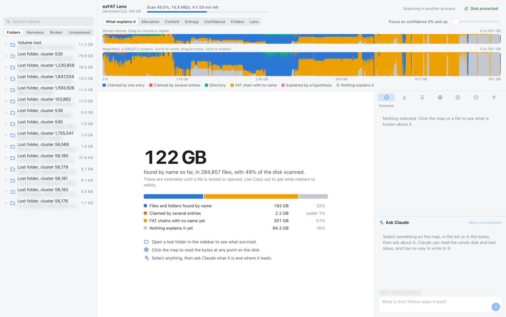
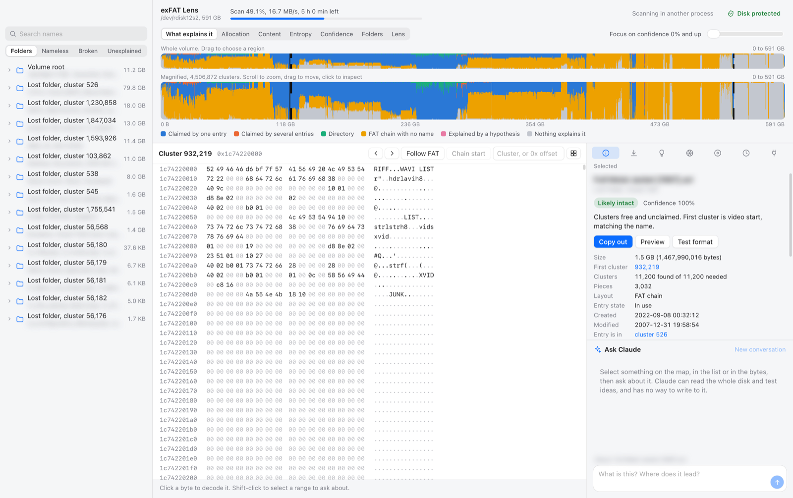
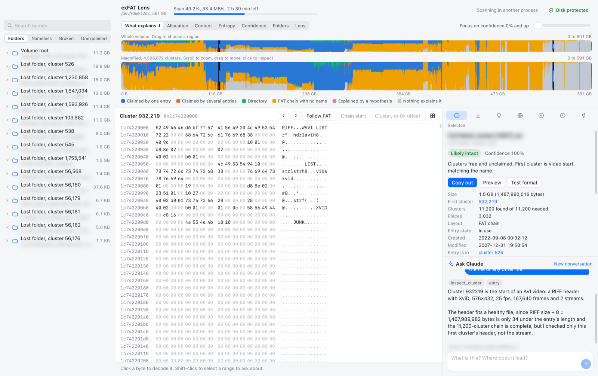
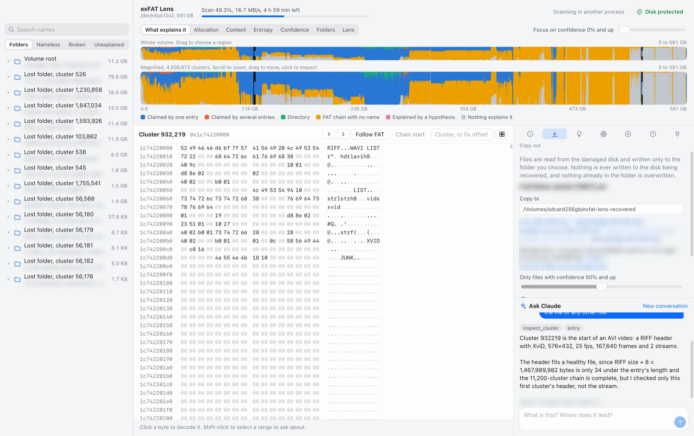
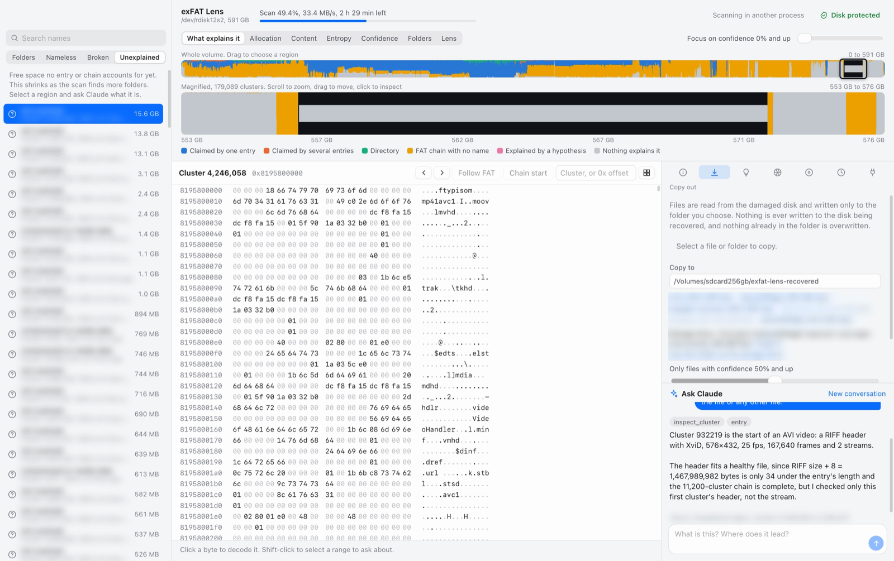
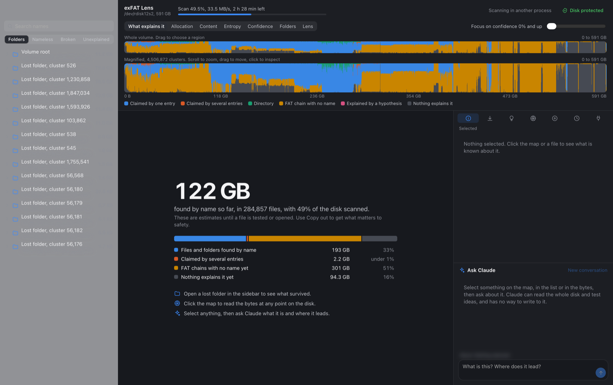
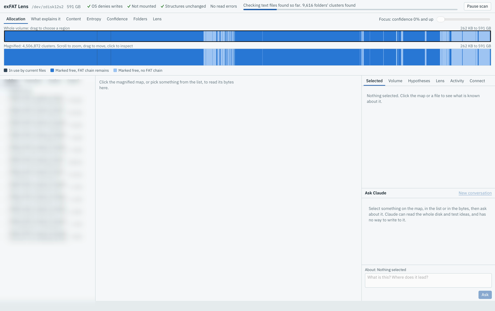
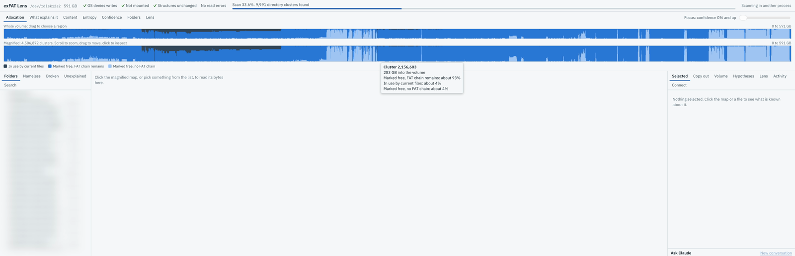

# Captain Salvage

Find the lost treasure on your old, broken drives.

Captain Salvage is a read-only disk recovery tool for macOS. When a repair tool
says a volume is fine but your files are gone, the data is often still there,
with only the links to it cut. This app reads the disk directly, maps what it
finds, and helps you get your files back, without ever writing to the disk.

> **Early development.** It works on one filesystem, exFAT, and has been tested
> on one real damaged volume plus synthetic test volumes. It is not released yet.
> The code and app window still use the working name, exFAT Lens.

## Development so far

Each version gets new screenshots, taken from the real damaged test disk. File names
on that disk are private, so they are blurred.

### Latest

The overview says what has been found, and the map shows what explains every part of
the disk. Blue is claimed by a named file, orange is a FAT chain with no name yet, and
grey is not explained yet.



Pick any file to read its bytes, see why it got its score, and copy it out. This film's
header shows a healthy AVI file, in 3,032 pieces with none missing.



Select anything and ask Claude, who checks with the same tools the app uses.



Copy out checks the destination, and refuses the disk being recovered.



The Unexplained list zooms the map to free space nothing accounts for yet.



It follows your Mac's dark mode too.



### Earlier versions

The first version looked like this. It worked, but the map hid the 32 GB in use,
because each column showed only its largest category.



Next, each map column became a stack showing its real mix, so small things stay visible.



## What makes it different

Most tools give a yes or no. A checksum fails, so the file is gone. Captain Salvage
treats damage as something to route around:

- **It weighs damage.** A damaged entry gets a lower confidence score, not a
  rejection. If it points at a real folder, the trail continues.
- **It shows the whole disk.** The map shows what explains every cluster: a named
  file, a folder, a FAT chain with no name, or nothing yet. Zoom from the whole
  volume down to single bytes.
- **It keeps your theories separate from the disk.** A hypothesis, such as "these
  clusters belong to this file", is an overlay you can switch off. The map
  recalculates, and the disk is never touched.
- **It tests its guesses.** It walks PNG chunks, JPEG markers, MP3 frames and zip
  CRCs through a reassembled file, and reports where the file breaks.
- **An AI can investigate with you.** Select anything and ask Claude about it.
  Claude works through the same tools as the app, over MCP, and has no write path
  to the disk.

## Safety

The disk being recovered is never written to. That is the rule the design starts from.

- Devices are only ever opened read-only, and the read interface has no write method.
- The volume stays unmounted during a scan, because macOS writes to a volume when it mounts it.
- The app checks that the boot regions, FAT, bitmap and root directory still match
  their first-recorded hash.
- Copy out refuses any destination on the disk being recovered, including through
  an APFS container, and refuses if it cannot tell which disk a destination is on.
- Copy out never overwrites a file. Each copy is hashed as it is read, then hashed
  again from the destination.
- Only the person using the app can start a copy or choose a salvage drive. An AI can
  plan a copy, but not start one.

## How far to trust the results

Confidence scores are estimates. Testing on one real damaged volume found:

| Test | Result |
|---|---|
| PNG files, checksums on every chunk | 25 of 25 fully valid |
| JPEG files, structure only, because JPEG has no checksums | 25 of 25 at least 99.99% valid |
| Zip archives, CRC on every member | 6 of 7 fully valid |
| A 1.1 GB film in 4,042 pieces, full decode | Decoded, with frames checked by eye |

The seventh zip had been scored at 100% confidence, yet one of its 376 members fails
its CRC. Bad data inside a file can look perfect from the outside, so test or open
what matters. Nothing is recovered until it is safely on another disk and you have
checked it. Some files will not come back.

## Running it

You need macOS, Rust and Node.js.

```sh
npm install
npx tauri build --bundles app
open "target/release/bundle/macos/exFAT Lens.app"
```

**First, keep the damaged volume unmounted, and don't run First Aid or `fsck` on it.**
A repair may be what made your files disappear, and it could overwrite what is left.

```sh
diskutil list                          # find the disk, such as disk4s2
diskutil unmount /dev/disk4s2
sudo chgrp staff /dev/rdisk4 /dev/rdisk4s2
```

The last command gives your account read-only access to the raw device until the disk
is reconnected. Reconnecting also mounts the volume again and can change its number.

Then open the app, and enter the partition's device, such as `/dev/rdisk4s2`.

### Scanning from a terminal

```sh
cargo build --release -p lens-core
./target/release/lens-scan /dev/rdisk4s2
```

A scan reads the whole partition once, and can stop and resume at any time.

### Tests

```sh
cargo test -p lens-core
```

### Screenshots

```sh
scripts/take-screenshots.py media/v4
```

This drives a second copy of the app off screen, with file names blurred. Look at every
image before committing it, because bytes and chat answers can still hold names.

## Using it from an MCP client

The app runs an MCP server on localhost, protected by a token. Its **Connect** tab shows
the command that adds it to Claude Code. There are more than 40 tools, covering raw reads,
FAT chains, pattern search, read-only SQL on the map, format tests, overlays and sandboxed
scripts.

## Distribution

The aim is the Mac App Store, but **the current design cannot ship there**. See
[#1](https://github.com/antimatter-studios/captainsalvage/issues/1). In short, store apps
must be sandboxed and cannot ask for root, and this app reads raw devices, runs the `claude`
command and uses a private window API. A build signed and notarized for direct download
does not have these limits.

## Playing more formats

The window plays common formats by itself. Install [ffmpeg](https://ffmpeg.org) with
`brew install ffmpeg` and the app finds it and also plays AVI, MKV, MPG, FLV, WMV, WMA and
others, converting them as they play. It also shows a frame from each video in the grid.
ffmpeg is optional, is not bundled, and nothing it converts is saved.

## Roadmap

Bugs, ideas and progress are all in the
[issue tracker](https://github.com/antimatter-studios/captainsalvage/issues).

## License

MIT. See [LICENSE](LICENSE).
